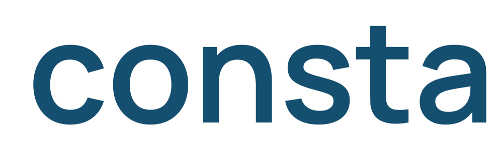

# Consta



**Gestão de ativos hospitalares: dos documentos à manutenção concluída, com localização automática dos equipamentos móveis.**

O Consta reúne cadastro de ativos, contratos, planos de manutenção, responsáveis, tarefas e comprovantes. A IA auxilia a extração documental com revisão humana. O rastreamento seguirá com **tags BLE a bateria, receptores fixos e processamento na rede local**, limitado aos equipamentos e às áreas aprovados pelo hospital.

**Estado real:** este repositório contém documentação, identidade visual e dados fictícios. O CRM, o serviço de localização e o hardware ainda serão construídos. A escolha de BLE é uma direção de desenvolvimento; compatibilidade hospitalar, precisão, autonomia e atualização ainda precisam de validação. Consulte o [estado atual](docs/estado-atual.md).

## Comece por aqui

| Preciso… | Leia |
| --- | --- |
| Entender o produto e seu escopo | [Visão do produto](docs/produto/visao.md) e [requisitos](docs/produto/requisitos.md) |
| Começar a desenvolver com a equipe | [Primeiros passos](docs/desenvolvimento/primeiros-passos.md) e [contribuição](CONTRIBUTING.md) |
| Trabalhar com uma LLM | [Instruções para agentes](AGENTS.md) |
| Entender as partes e suas interfaces | [Arquitetura](docs/arquitetura/visao-geral.md) e [contratos de integração](packages/contratos/README.md) |
| Desenvolver o rastreamento | [Arquitetura BLE](docs/rastreamento/arquitetura-ble.md) e [segurança hospitalar](docs/rastreamento/seguranca-hospitalar.md) |
| Escolher a próxima entrega | [Backlog](docs/desenvolvimento/backlog.md) |
| Encontrar uma decisão ou uma fonte | [Índice da documentação](docs/README.md) |
| Preparar o problema do pitch com casos reais | [Notícias, respostas dos hospitais e limites](docs/referencias/noticias-para-pitch.md) |
| Usar o corpus público para avaliar o CRM | [Estudo do pacote de pesquisas](docs/referencias/estudo-pacote-pesquisas.md) e [casos de avaliação](data/referencias/README.md) |

## Organização do repositório

```text
apps/crm/                 Aplicação de gestão — implementação pendente
services/localizacao/     Recepção e estimativa de localização — implementação pendente
packages/contratos/       Especificação das interfaces entre software e receptores
hardware/                 Especificações de tag e receptor — fabricação pendente
docs/                     Produto, arquitetura, desenvolvimento, fontes e decisões
brand/                    Wordmarks atuais, tokens e apresentação da identidade
data/                     Exemplos e cenários exclusivamente fictícios
scripts/                  Verificação do repositório
.github/                  Verificação automatizada e modelo de pull request
```

As pastas de aplicação, serviço e hardware têm guias de escopo, não aplicações executáveis. A stack permanece [em decisão](docs/arquitetura/visao-geral.md). O CRM poderá ser desenvolvido e demonstrado com um adaptador de localização simulado, identificado como tal.

## Direção atual

- **CRM:** documentos → extração com evidência → revisão → plano → tarefa → execução → histórico.
- **Localização:** tag BLE → receptor fixo → rede cabeada → serviço local → CRM. Sem escaneamento operacional ou dependência de celulares pessoais.
- **Escopo hospitalar:** equipamentos móveis e áreas autorizados; ressonância e outras áreas especiais ficam fora da implantação inicial.
- **Óptica:** descontinuada e removida da árvore atual. O [registro histórico](docs/historico/optica-descontinuada.md) explica a decisão e como consultar os experimentos anteriores no Git.

## Verificação disponível

Na raiz, com Python 3.9 ou posterior:

```sh
python3 scripts/verificar_repositorio.py
```

O comando verifica referências locais da documentação e recursos da marca. Ainda não existem comandos para executar ou testar o CRM; eles deverão acompanhar sua implementação.

## Identidade visual

[Galeria e downloads](brand/index.html) · [Guia de marca](brand/README.md)

Identidade de Pedro: **CONSTA.**, sem símbolo floral. Preto `#0A0A0A`, laranja `#F97316`, vermelho `#E63946` e branco `#FAFAF9`; DM Mono na marca e nos dados, Inter na interface. O [logo na raiz](consta-logo.svg) usa a wordmark atual. A referência ao hackathon HCFMUSP não representa aprovação institucional ou parceria de implantação.
