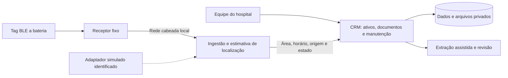

# Arquitetura geral

Arquitetura de referência para a primeira implementação. O [estado atual](../estado-atual.md) identifica o que já existe. Os limites abaixo organizam responsabilidades; não obrigam a criar microserviços ou infraestrutura externa.

## Responsabilidades

| Componente | Responsabilidade | Limite |
| --- | --- | --- |
| [CRM](../../apps/crm/README.md) | Ativos, documentos, contratos, planos, tarefas, acesso e auditoria | Consome localização; não deduz liberação técnica a partir dela |
| Extração documental | Sugerir campos com evidência, tratar lacunas e permitir revisão | Não aprova plano nem determina prazos por conta própria |
| [Localização](../../services/localizacao/README.md) | Receber observações, validar, deduplicar, estimar e expor última localização | Não decide manutenção, disponibilidade ou uso clínico |
| [Contratos compartilhados](../../packages/contratos/README.md) | Especificar mensagens e comportamentos das integrações | Não concentra toda a lógica do domínio |
| [Hardware](../../hardware/README.md) | Transmitir identidade e receber sinais em posições conhecidas | Não declara por si só segurança hospitalar ou sala correta |

O CRM é a autoridade para cadastro de ativos e associação temporal tag–ativo. A localização é responsável pelas observações e pela estimativa. O mecanismo de sincronização da associação ainda será definido; sem associação confiável, a observação fica não resolvida, em vez de ser atribuída por suposição.

## Stack: recomendação e escolha pendente

Recomenda-se aplicação web com TypeScript, banco relacional PostgreSQL, armazenamento privado de arquivos e processamento persistente para extração, prazos e notificações. Framework, ORM, autenticação, gerenciador de pacotes, provedor de IA e hospedagem ainda não foram escolhidos. Não há `package.json`, ambiente de banco ou aplicação inicializados nesta reorganização.

Começar com o backend de gestão na aplicação do CRM reduz fronteiras de implantação. Processos em background e a recepção de observações poderão ser separados quando seus requisitos justificarem. As pastas marcam fronteiras lógicas e permitem coordenação, sem impor banco ou fila independentes para cada uma.

## Dependências e persistência

- UI chama casos de uso do CRM; as regras não dependem da tela ou da LLM.
- Integrações entram por adaptadores com contratos explícitos. O adaptador simulado não se apresenta como receptor físico.
- Jobs usam estado persistente, idempotência e recuperação após falha. Um temporizador de navegador não é o agendador de manutenção.
- O CRM consulta localização por interface definida; não depende de detalhes do algoritmo ou de dados brutos do rádio.
- Alteração de banco exige migração e estratégia de preservação dos registros; documentos e planos são versionados.

## Operação local

O caminho essencial de localização deve ficar no hospital: receptores, transporte, ingestão, persistência, autenticação necessária e consulta. Dependências de licença, DNS, relógio, autenticação e frontend precisam funcionar no cenário local previsto. Um banco local com motor de localização em nuvem não atende a esse requisito.

A extração documental pode usar provedor externo; sem internet, deve permanecer pendente e permitir cadastro/revisão manual. Não prometemos IA offline antes de escolher e testar uma alternativa. Veja [segurança e operação](seguranca-e-operacao.md).

## Decisões

- [BLE no escopo móvel e retirada da óptica](../adr/0001-rastreamento-ble.md).
- [Repositório único com fronteiras por responsabilidade](../adr/0002-monorepo.md).
- Futuras escolhas estruturais devem registrar contexto, alternativa escolhida e consequência em `docs/adr/`, indicando se são propostas ou aceitas.
