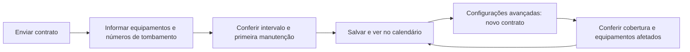

# Fase 1 — Contrato, equipamentos e calendário

## Objetivo

Um CRM simples: enviar um contrato, identificar os equipamentos cobertos e acompanhar as manutenções previstas. A interface reúne calendário, inventário e consulta de contratos. O cadastro usa duas telas curtas, **sem indicador de estágio, numeração ou formulário extenso**.

Implementação local em [apps/crm](../../apps/crm/README.md): React 19 + Vite, API Express e SQLite. O SDK de IA está integrado; URL, chave e modelo ficam para configuração do usuário. Nenhuma extração foi validada com provedor real.

## Como deve ser o diálogo

**Primeira tela — Envie o contrato.** Uma área de upload e Continuar. Um PDF pode cobrir várias unidades físicas. A alternativa discreta de preenchimento manual continua disponível. Quando configurada, a IA identifica todos os equipamentos do documento e preenche os campos documentados de cada um, com evidências. Não cria números de tombamento por suposição nem aprova regras.

**Segunda tela — Confira os equipamentos.** Mostrar uma tabela editável, com uma linha por equipamento retornado pela IA, com estes campos principais. O botão **Detalhes** abre uma janela flutuante sobre a tabela, com abas Identificação, Contrato e Dados da IA. A janela pode ser arrastada pelo cabeçalho ou movida pelas setas do teclado, dentro dos limites do cadastro. A tabela permanece visível e utilizável, com a linha selecionada destacada. Concluir edição fecha apenas os detalhes e preserva o rascunho; gravar os cadastros continua sendo uma ação separada. Em telas pequenas, a janela fica fixa. Apenas a tabela e o conteúdo interno dos detalhes rolam; cabeçalho e ações ficam fixos. **Adicionar equipamento** fica no topo direito da tabela:

- Equipamento e número de tombamento, preenchidos quando constarem no documento. **Adicionar equipamento** permite incluir uma unidade manualmente.
- Manutenção a cada: número e unidade de intervalo.
- Primeira manutenção: data do ciclo conferida pela pessoa.
- **Confirmar e salvar**, quando houver regra completa; **Salvar cadastro**, quando ainda faltar informação.

Nenhum checkbox extra ou campo de marco técnico é exigido no caminho principal. Confirmar e salvar é a revisão humana explícita. Sem intervalo ou data suficiente, o cadastro fica pendente e não gera previsões. Uma série do fabricante não substitui o número de tombamento da etiqueta institucional/governamental.

Cada ficha mantém sua própria identidade, modelo, série, setor, observações, intervalo, primeira data e vigência. **As regras não são compartilhadas automaticamente entre modelos diferentes.** A extração só replica uma cláusula comum quando o documento a aplica explicitamente aos respectivos equipamentos, preservando a evidência em cada linha.

Se o documento trouxer apenas modelo e quantidade, sem identificar unidades, a extração retorna um grupo com a quantidade declarada e identidades vazias. A tela informa essa limitação e permite adicionar unidades, preenchendo os números de tombamento. Não registra automaticamente dez ativos fictícios porque um contrato menciona dez unidades.

O upload idêntico reutiliza o arquivo por hash. Um lote de até 50 fichas é salvo de forma atômica: erro em uma identidade ou regra não deixa as demais parcialmente cadastradas. Equipamentos já conhecidos são identificados por número de tombamento ou pelo vínculo de edição explícito, sem duplicar cadastros. Um novo contrato usa renovação explícita por linha e preserva o histórico.

Voltar preserva os campos e o documento. Editar um equipamento abre diretamente a configuração; permite abrir todos os itens de uma leitura múltipla já disponível, por Mostrar todos os equipamentos deste contrato. A releitura é explícita e substitui os campos do formulário, sem gravar nada antes da confirmação. Nenhum novo equipamento é criado sem número de tombamento informado pela pessoa.

## Configurações avançadas

Ficam recolhidas na segunda tela:

| Opção | Comportamento |
| --- | --- |
| Cobertura de / até | Datas explícitas de cobertura de manutenção; não confundir garantia com periodicidade ou vigência |
| Modelo, setor, série e observações | Detalhes opcionais; série individual disponível para cadastro de uma unidade |
| Informações do contrato | Sugestões, página/trecho, ausências, conflitos e nova tentativa de extração |
| Contratos do equipamento | Documentos anteriores e períodos preservados, com links para os arquivos |
| Adicionar novo contrato | Renovação da cobertura sem apagar o documento ou as regras anteriores |

Quando há aviso/conflito da extração, a interface sinaliza que a fonte precisa ser conferida. A evidência permanece acessível nas configurações avançadas.

## Renovação e vencimento

Um equipamento pode ter vários contratos ao longo do tempo; um contrato pode cobrir vários equipamentos. A relação é representada por **coberturas por equipamento**, com documento, intervalo, referência do ciclo, vigência e revisão próprios.

Para renovar: abrir o equipamento → Configurações avançadas → Adicionar novo contrato. Selecionar o documento, informar início da nova cobertura, fim quando conhecido, conferir a regra e confirmar. A leitura do novo documento mostra as fichas encontradas. Conferir as unidades que receberão a nova cobertura; fichas removidas da lista não são alteradas. Cada uma usa sua própria regra e início de vigência. A identidade da unidade originalmente escolhida precisa estar presente para confirmar a renovação. A atualização do lote é atômica e preserva os dados de unidades não incluídas.

Regras da implementação:

- A data final de cobertura é inclusiva; não gerar previsões posteriores a ela.
- Não inferir data de cobertura a partir do upload. Data ausente permanece explicitamente desconhecida; sem fim informado, não há vencimento conhecido para limitar as projeções.
- A renovação exige início explícito e um contrato diferente, ainda não usado no histórico do equipamento.
- O documento e a cobertura anterior são preservados. A nova cobertura revisada passa a valer a partir do seu início; a anterior deixa de gerar datas desse ponto em diante, sem duplicação por sobreposição.
- Se o contrato anterior terminar antes do próximo começar, o intervalo sem cobertura continua sem previsões contratuais. Não preencher a lacuna silenciosamente.
- Um novo contrato pendente de revisão não ativa a substituição do anterior. O vencimento já conhecido do contrato anterior continua sendo respeitado.
- Renovação de vários equipamentos é atômica e só afeta os selecionados.
- Alterar ou adicionar um contrato não prova execução de manutenção ou liberação técnica.

## Diagrama simples

## Contrato da extração com IA

A resposta estruturada tem `version: 2`, `equipments` e avisos gerais. Cada item de `equipments` contém `equipment`, `patrimony`, `serial`, `model`, `sector`, `notes`, `quantity`, `periodValue`, `periodUnit`, `firstDueDate`, `anchorDate`, `anchorType`, `validFrom`, `validUntil` e avisos próprios. Cada campo preserva valor, estado encontrado/ausente/conflitante, página e trecho. Ausências ou conflitos ficam sem valor; datas de manutenção podem ser calculadas deterministicamente a partir da referência documental válida, sem usar o upload como marco.

Leituras antigas continuam legíveis. Quando a IA estiver configurada, Continuar reprocessa uma leitura antiga antes de abrir a lista. Sem configuração, a tela sinaliza a leitura antiga e permite preenchimento manual. Resposta sem equipamentos mostra uma lista vazia e opção de cadastro manual, em vez de inventar um equipamento.

## Calendário

Visão mensal, busca e acesso ao cadastro. Datas são projeções por equipamento, com contrato de origem na resposta da API. A consulta respeita a cobertura, a revisão e as substituições. Cada intervalo consultado tem até dois anos; a grade mensal usa 42 dias.

Ciclos suportados: dias, meses e anos. Meses não viram dias fixos. Quando a extração identifica referência válida e periodicidade, o cálculo preserva essa referência original, inclusive fim de mês. Ao informar manualmente a primeira manutenção ou mudar o intervalo, a regra passa a usar essa data conferida como base. Uma janela condicional, uso por horas/ciclos ou manual ausente exige complemento; a LLM não inventa datas.

No inventário, todas as unidades cadastradas aparecem individualmente com número de tombamento/série, setor, último contrato/cobertura, periodicidade, próxima manutenção e situação da revisão. A busca aceita nome, número de tombamento, série, modelo, setor e nome do contrato. A próxima data respeita vencimento, lacunas e renovações, mesmo fora do mês atualmente aberto no calendário.

O histórico implementado preserva os documentos e as coberturas anteriores. Edição da regra da cobertura mais recente ainda altera sua projeção; não há livro de execuções realizadas nem versionamento imutável de toda edição de plano.

## Critérios de aceite

- Upload → configuração simples → confirmação → previsões persistidas funciona.
- A extração múltipla preenche e preserva dados distintos de cada equipamento, inclusive regras diferentes e evidências por campo.
- Um documento se vincula explicitamente a várias unidades, sem repetir número de tombamento ou criar unidades por suposição.
- Cadastro/renovação em lote não deixam gravação parcial quando houver erro.
- Vencimento, sobreposição, lacuna e cobertura pendente são tratados sem datas inventadas ou duplicadas.
- Novo contrato preserva o anterior e não altera equipamentos não incluídos no lote.
- Migração aditiva mantém cadastros, contratos e calendário legados após reinício.
- Falha de leitura permite nova tentativa ou preenchimento manual; evidências ficam disponíveis para revisão.

O modo local sem senha é somente para dados sintéticos. Senha local não implementa autorização por usuário/instituição. BLE, execução, comprovantes, integrações hospitalares e notificações continuam fora deste recorte; consultar o [backlog](../desenvolvimento/backlog.md).

## Consulta de documentos e unidades

A área **Contratos** permite buscar e abrir qualquer documento enviado, inclusive sem cadastros confirmados. A prévia digital apresenta PDF no leitor do navegador ou TXT como texto, com acesso ao arquivo original. A opção **Equipamentos** mostra todas as unidades vinculadas ao documento, incluindo coberturas anteriores; não confunde itens apenas extraídos pela IA com unidades efetivamente cadastradas.

O nome de um equipamento no inventário, no calendário ou na consulta do contrato abre sua ficha: identificação, número de tombamento, série, setor, regras do último plano, próxima manutenção determinística, observações e histórico de coberturas. **Editar equipamento** abre o fluxo de revisão existente. Contratos na ficha e no cadastro abrem a mesma prévia. Consultar documentos não solicita extração de IA.

Ao abrir um contrato, **Equipamentos** é a primeira aba e já vem selecionada; **Documento** é a segunda. A ficha abre como janela flutuante arrastável sobre a mesma consulta, sem fechar o contrato nem perder o scroll da lista. A linha selecionada fica destacada; fechar a ficha devolve o foco ao equipamento. O cabeçalho também aceita movimento pelas setas. Em telas pequenas, a janela fica fixa.

## Equipamentos: responsabilidade e cobertura

A lista de equipamentos prioriza quem cuida da manutenção e o que precisa de atenção. Sem cards e contadores, mantém equipamento/modelo, número de tombamento, setor, situação da manutenção, próxima previsão e acesso à ficha. A busca e o filtro atendem à gestão pela engenharia clínica; situações de atenção aparecem primeiro.

Contrato vigente exige documento, revisão e início/fim conhecidos abrangendo a data atual. Sem datas ou revisão, mostrar Conferir cobertura. Vencimento, início futuro e intervalo sem cobertura continuam visíveis. Renovação pendente ou futura não elimina a indicação da cobertura anterior ainda válida.

Oficina de Manutenção é uma responsabilidade interna escolhida pela pessoa, nunca inferida pela ausência de contrato. Definir manutenção oferece Por contrato, Oficina de Manutenção e Ainda não definido. Alterar responsabilidade mantém arquivos, histórico e planejamento; não cria datas ou comprova serviço realizado. Na ausência de responsabilidade, a lista indica Manutenção a definir.

### Definir manutenção em duas telas

A primeira tela contém as três opções de responsabilidade. **Empresa externa** e **Continuar** abrem a segunda tela: tipo (**Termo aditivo** ou **Contrato de manutenção terceirizada**), upload e Voltar/Salvar no histórico. As duas opções ficam visíveis no seletor segmentado, com uma explicação curta conforme a escolha. O upload reutiliza o componente visual do cadastro de equipamentos; nome e tamanho identificam o arquivo escolhido. Cabeçalho, conteúdo e ações compartilham os mesmos alinhamentos. Não há descrição opcional. Oficina e responsável não definido salvam diretamente.

O equipamento já pertence a um contrato principal. Um aditivo altera esse contrato; um contrato terceirizado representa a contratação de outra empresa e fica relacionado ao principal para consulta conjunta. As classificações permanecem distintas no histórico da unidade e nos documentos vinculados. A API exige contrato de origem e impede criar um principal por esse caminho. Nada é enviado antes de **Salvar no histórico**. O envio preserva cobertura e planejamento; o histórico documental não é um registro de serviços executados.

## Contratos principais e aditivos

A tela de Contratos agrupa cada principal e seus aditivos. A seta expande/recolhe a lista. Adicionar aditivo fica dentro dessa área expandida, ao lado do título Aditivos do contrato, e permanece disponível mesmo sem aditivos cadastrados. O usuário pode anexar PDF/TXT ou escolher um documento existente; Organizar permite vincular, mover ou desvincular um aditivo sem apagar arquivos.

Um aditivo aponta explicitamente para um único contrato principal. Documentos antigos continuam principais até a pessoa organizar o vínculo; não se infere relação pelo nome do arquivo. Não se permite aditivo de aditivo ou ciclos. O principal reúne, na consulta, equipamentos de seus documentos associados sem duplicar unidades; um aditivo isolado mantém a consulta de seus próprios vínculos. Buscar por aditivo mantém e expande o principal correspondente. A organização documental não aplica mudanças de vigência ou regras automaticamente.

A leitura rápida da lista usa bandeira vermelha à esquerda para pendências, status em selo destacado e filtros visíveis por situação. Manutenção a definir aparece primeiro. Cada linha mostra um único status, sem instruções complementares como “Complete as datas do contrato”. Motivos, modelo e datas ficam na ficha; o destaque vermelho indica uma pendência de gestão, sem afirmar falha clínica ou indisponibilidade técnica.

## Marca do equipamento

Nome, marca e modelo são dados separados. Na lista, o nome permanece junto da bandeira de atenção, com marca e modelo em uma linha compacta abaixo; tombamento e setor continuam visíveis. A marca aparece também na ficha, no cadastro/configurações de identificação, nas evidências da IA e na consulta de equipamentos do contrato. A busca aceita marca/modelo.

A IA preenche a marca apenas quando associada ao equipamento no documento, com evidência própria. Não usa fornecedor/assistência como marca nem deduz a partir do modelo. Sem marca, permanece em branco. Cadastros e leituras anteriores continuam funcionando; a marca é opcional e edições por clientes antigos não apagam o valor salvo.

## Quebras e reparos agendados

A ficha oferece **Registrar quebra** no rodapé. A ação abre um diálogo sobreposto no padrão das demais janelas; a ficha não expande um formulário. Informar agendamento é opcional. Depois de salvar, a unidade aparece como **Equipamento quebrado**, com flag vermelha, prioridade e filtro na lista. Uma data informada gera **Reparo agendado** em vermelho no calendário/agenda, separado da preventiva. É possível alterar ou retirar o agendamento e informar reparo, encerrando a flag e preservando o histórico. Sem data, não se inventa um evento.

Foram retirados da ficha Gerenciar manutenção e a apresentação da pendência de prazo do contrato. O resumo mantém identificação, quem atende e previsão preventiva. Quem atende é a empresa do vínculo de manutenção mais recente; nome, telefone e e-mail vêm da extração do documento e podem ser conferidos no cadastro. Se o nome não for encontrado, mostrar Empresa terceirizada; não reutilizar os contatos de outra empresa de um contrato anterior. Os documentos continuam acessíveis. Esta escolha de contato não confirma vigência nem comprova execução/liberação técnica.

## Consulta unificada de contratos

Decisão de interface: **Contratos** é a área; contrato principal, termo aditivo, contrato terceirizado e anexo são os tipos. **Arquivo** designa PDF/TXT, não uma segunda área de produto. Os rótulos principais são centralizados para evitar versões concorrentes de copy.

Um único diálogo apresenta **Visão geral**, **Arquivo** e **Equipamentos**. A navegação lateral contém o principal e os arquivos vinculados explicitamente. A entrada pelo aditivo ou terceirizado mantém esse item selecionado e abre seu conteúdo; a troca lateral reutiliza a janela. A entrada por “Ver equipamentos” abre a lista diretamente. O principal agrega as unidades do grupo; cada vínculo mantém sua associação própria.

Adicionar e organizar arquivos usam o mesmo padrão visual, com contrato de origem em destaque. Adicionar oferece envio ou seleção de arquivo existente e classificação do vínculo. A operação organiza os arquivos sem aprovar planos ou alterar datas automaticamente.

## Navegação recolhível e leitura rápida de contratos

A sidebar da Fase 01 destaca cadastro, Calendário, Equipamentos e Contratos. Mantém a mensagem “Do contrato à próxima manutenção.”. O usuário pode ajustar a largura, arrastar até fechar ou usar o botão; o cabeçalho oferece reabertura. Preferências são locais ao navegador. Totais de volume saíram dos links; somente quebras ainda não resolvidas podem produzir o indicador de reparos pendentes, com acesso direto à lista filtrada.

No leitor de contratos, os arquivos vinculados aparecem em árvore recolhível. A Visão geral solicita um resumo salvo somente ao ser aberta. Sem configuração, mostra Lorem identificado; com chave/modelo, gera e salva a síntese para gestão clínica, com pontos curtos e trechos sugeridos de origem. Não há regeneração a cada abertura. A síntese não aplica datas, aprova planos ou decide disponibilidade de equipamento.
