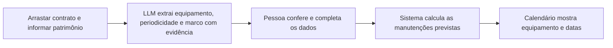

# Fase 1 — Contrato e calendário de manutenção

## Objetivo

Um CRM simples com duas telas: cadastrar um equipamento a partir de um contrato e consultar as manutenções previstas no calendário. Este recorte segue a orientação mais recente do usuário e define a primeira fase; o restante do produto fica para etapas posteriores.

**Implementação inicial disponível em [apps/crm](../../apps/crm/README.md):** React 19 + Vite, API local, SQLite, upload PDF/TXT, revisão manual e calendário. O SDK está integrado; URL, chave e modelo serão configurados pelo usuário. A leitura com um provedor real permanece sem validação.

## Diagrama do fluxo

Se o contrato não informar periodicidade ou marco inicial suficiente, o cadastro fica pendente de complemento. O sistema não inventa uma data. A revisão acontece no próprio formulário, sem exigir uma tela ou processo complexo de aprovação.

## Tela 1 — Cadastrar por contrato

O diálogo tem **duas etapas**: (1) envio do contrato; (2) campos do equipamento, evidências e revisão da manutenção. O botão Continuar só é habilitado após o upload; a alternativa explícita de preenchimento manual mantém a contingência sem contrato. Não há indicador de etapas ou numeração na interface. Quando a IA está configurada, Continuar executa a leitura antes de abrir os campos. Campos opcionais ficam em Mais informações e as evidências em Ver informações do contrato. É possível voltar sem perder os dados. Editar um equipamento existente abre diretamente os campos, com opção de trocar o contrato; um arquivo diferente invalida a regra anterior até nova revisão.

1. Arrastar o contrato para uma área de upload ou selecionar o arquivo.
2. Informar o **número de patrimônio da etiqueta institucional/governamental**. Número de série do fabricante é um campo separado e opcional; os identificadores não devem ser confundidos.
3. Aguardar a leitura do contrato e visualizar os campos sugeridos: equipamento/modelo, periodicidade, marco inicial e condições aplicáveis.
4. Conferir e corrigir os campos no mesmo formulário. A sugestão mostra página/trecho de origem; campos ausentes ou conflitantes ficam sinalizados.
5. Completar a data do marco quando necessária, por exemplo instalação ou última manutenção, conforme a regra documental. Salvar o equipamento e as previsões confirmadas.

O cadastro representa uma unidade física. Se o contrato cobrir vários equipamentos, o vínculo com cada patrimônio precisa ser explícito; a LLM não cria unidades físicas por suposição.

## Tela 2 — Calendário

Visão mensal com navegação entre meses. Cada entrada mostra equipamento, patrimônio e manutenção prevista. Ao clicar, abre o cadastro com regra utilizada e acesso ao contrato. A implementação inicial aceita intervalos fixos em dias, meses e anos a partir de uma data conferida. Regras condicionais, por uso ou apenas uma janela sem data suficiente ficam pendentes de complemento; o sistema não escolhe um dia arbitrário.

Ao salvar um cadastro revisado, as previsões aparecem no calendário. Corrigir o cadastro recalcula suas previsões sem duplicá-las. Cadastros incompletos aparecem como pendências de cadastro, sem eventos com datas inventadas. As previsões são calculadas para os 42 dias da grade mensal consultada; cada consulta de API admite intervalo de até dois anos. Não representam execuções realizadas. Histórico de versões de plano e execução pertencem às próximas fases.

## Responsabilidades simples

| Parte | Função nesta fase |
| --- | --- |
| Interface com React 19 e Vite | Formulário com upload, conferência dos campos e calendário |
| Backend | Receber arquivo, chamar a LLM, controlar acesso, salvar dados e calcular datas |
| LLM | Sugerir campos e evidências do contrato; não prever falhas do equipamento |
| Regras de calendário | Calcular datas a partir de periodicidade e marco conferidos |
| Persistência e arquivos privados | Guardar equipamento/patrimônio, contrato, extração revisada e previsões |

Vite com React 19 foi solicitado para a interface; Express e SQLite compõem a implementação local inicial, conforme o [ADR](../adr/0004-crm-fase-1.md). A integração com a LLM fica no backend, com credenciais fora do navegador. Nenhum provedor foi contratado ou chave criada. Sem a configuração, o preenchimento manual permanece disponível e a leitura automática fica desabilitada.

“Prever manutenção” significa projetar obrigações previstas no documento. Por exemplo: periodicidade de seis meses a partir de uma instalação confirmada gera datas por essa regra. Não significa que a IA prevê quando a máquina quebrará. O upload não é automaticamente a data inicial do ciclo.

## Critérios mínimos de aceite

- Enviar contrato, informar patrimônio, revisar e salvar funciona; os dados permanecem após reinício.
- Cada sugestão documental apresenta sua origem ou indica ausência/conflito.
- Periodicidade ou marco ausente impede gerar a previsão correspondente até o complemento.
- Calendário mostra as previsões do equipamento certo; salvar novamente não duplica eventos.
- Falha de leitura permite tentar novamente ou completar os campos manualmente.
- Arquivo e dados são acessíveis apenas aos usuários autorizados; a demo usa dados sintéticos.

BLE, hardware, acompanhamento de execução, comprovantes, integrações hospitalares, notificações e painéis avançados ficam para fases posteriores. O [backlog](../desenvolvimento/backlog.md) registra a evolução sem ampliar esta primeira entrega. Sem senha configurada, o modo de demonstração usa somente dados sintéticos; a senha local não substitui autorização multi-instituição ou implantação hospitalar.
