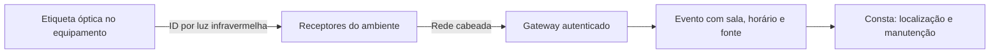

# Consta — dispositivo de rastreamento e explicação para o pitch

Pesquisa em 06/11/2026. Proposta de engenharia, sem protótipo ou validação clínica realizados. Esta nota aprofunda a seção de localização do projeto; não converte hipóteses anteriores em funcionalidades implementadas.

**Atualização de escopo:** a referência atual é [RTLS automático local](CONSTA_RTLS_AUTOMATICO_LOCAL.md). Matheus excluiu QR/escaneamento e definiu sensores fixos com processamento local sem dependência de internet. A hipótese óptica abaixo é uma alternativa histórica, não uma decisão final.

## Resposta à tarefa anterior

Para explicar um dispositivo automático sem adicionar transmissor de rádio ao equipamento, proponho estudar uma **etiqueta óptica ativa infravermelha**, presa externamente ao ativo, com receptores por ambiente e rede cabeada. Ela informa a sala da última detecção; não promete coordenadas contínuas ou precisão centimétrica.

**Essa é uma escolha de arquitetura condicionada à restrição de rádio, não uma prova de que infravermelho seja mais seguro que BLE.** Se o hospital autorizar RF e já possuir infraestrutura RTLS, integrar uma solução existente pode ser a opção mais viável. Não há razão demonstrada para desenvolver hardware proprietário no hackathon. A proposta óptica deve ser demonstrada inicialmente em bancada.

Há um precedente experimental direto: o Active Badge de Cambridge envia uma identidade por infravermelho para sensores distribuídos no edifício. Isso fundamenta o princípio de localização por ambiente, não a segurança clínica de uma nova etiqueta. [Cambridge, descrição original](https://www.cl.cam.ac.uk/research/dtg/attarchive/ab.html)

## O dispositivo e o funcionamento

A etiqueta teria identificação própria, microcontrolador sem rádio, emissor infravermelho, driver de corrente, bateria e invólucro higienizável. Sua fixação e posição seriam aprovadas para cada modelo de ativo. Não se conecta ao circuito da bomba nem altera firmware, configuração ou alimentação do aparelho.

1. No cadastro, vincular a identidade da etiqueta ao patrimônio e à série do equipamento. Não há leitura visual ou escaneamento no fluxo de localização atual.
2. A etiqueta transmite pulsos de luz com seu identificador e dados mínimos de integridade/estado. Intervalo, potência, comprimento de onda e duração dos pulsos ficam a definir por ensaio; não são especificações aprovadas.
3. Receptores ópticos no teto ou parede reconhecem o identificador. Cada receptor tem ambiente cadastrado e conexão cabeada. Mais de um receptor pode ser necessário em um ambiente com obstáculos.
4. O gateway registra identidade, receptor, instante observado, instante recebido e qualidade da observação. A rede pode usar Ethernet; PoE é opção para alimentar receptores, condicionada à instalação elétrica e de dados aprovada.
5. O Consta associa o receptor à sala e mostra **última detecção**, horário e procedência. A tarefa preventiva abre a mesma ficha do ativo.
6. Leituras repetidas sustentam mudança de ambiente. Detecção por salas vizinhas ou sinal insuficiente produz estado ambíguo; ausência de leitura produz estado desatualizado. Não extrapolar uma posição atual quando a etiqueta ficou coberta ou sem bateria.
7. Antes de recolher ou intervir, o profissional confere patrimônio/série. A localização não libera o equipamento para uso nem comprova disponibilidade.

O pulso óptico deve ter detecção de erros; retransmissões e tratamento de colisões precisam de projeto. Um código reconhecido não é necessariamente autêntico: avaliar falsificação/replay, autenticar gateways e registrar mudanças de associação. Não transmitir dados de pacientes.

## Por que isso pode reduzir um mecanismo de interferência

BLE, Wi-Fi, UWB e RFID usam radiofrequência. Na proposta óptica, a transmissão do identificador ocorre por luz e o caminho de retorno é cabeado. Portanto, **não adicionamos uma portadora intencional de rádio na etiqueta**. Essa é a propriedade física que podemos defender antes dos testes.

Mas infravermelho também é radiação eletromagnética. Microcontrolador, driver, fonte, cabeamento e receptor podem gerar emissões não intencionais ou sofrer perturbações. Não ter antena RF não demonstra compatibilidade eletromagnética de todo o conjunto. A FDA distingue a compatibilidade com o ambiente das emissões capazes de perturbar outros aparelhos. [FDA, EMC](https://www.fda.gov/radiation-emitting-products/radiation-safety/electromagnetic-compatibility-emc)

**Não usar a frase “não interfere porque é luz”.** Um estudo experimental de Mathes e colaboradores avaliou interferência de neuronavegação infravermelha na oximetria e encontrou perturbação de sinal e detecção de saturação. A fonte de luz e as condições eram outras: não prova dano da nossa etiqueta, mas demonstra uma via de interferência que precisa ser testada. [Estudo original, 2008](https://pubmed.ncbi.nlm.nih.gov/18633032/)

## Como avaliar qualidade dos exames e funcionamento

O resultado procurado é manter desempenho essencial e qualidade diagnóstica dentro dos critérios aprovados para cada equipamento. Não basta ligar o aparelho e observar se permanece funcionando. O protocolo deve ser definido pela engenharia clínica, fabricantes e responsáveis por cada modalidade; os critérios abaixo são propostas, não resultados obtidos.

| Ambiente/aparelho | O que verificar antes de liberar |
| --- | --- |
| Bombas e ventiladores | Desempenho essencial, alarmes, entrega/fluxo quando aplicável e ausência de alterações na configuração, usando simuladores e analisadores apropriados |
| ECG e monitores | Traçado, ruído, medidas e alarmes com simulador, variando etiqueta e receptores em operação |
| Oxímetros e sensores ópticos | Qualidade de sinal, falhas de reconhecimento e medidas sob iluminação pulsada; validar sensor e protocolo apropriados, sem extrapolar resultado de simulador a todas as condições clínicas |
| Radiografia, tomografia e fluoroscopia | Fixação fora do campo e trajeto necessários; avaliar artefatos/obstrução e métricas de imagem com fantoma sob protocolo da modalidade, sem exposição extra de pacientes |
| Ultrassom diagnóstico | Comparar imagem e sinais com fantoma; verificar ruído eletrônico, obstrução e geometria. Se a localização for acústica, avaliar também interação acústica na configuração real |
| Navegação óptica | Verificar competição óptica, perda de marcadores e comportamento do sistema sob o protocolo do fabricante |
| Ressonância magnética | Avaliação própria do conjunto: força/torque, aquecimento, funcionamento e artefatos. Desligar a etiqueta não elimina riscos de bateria, metais ou condutores |

Para a primeira etapa, manter o protótipo fora da sala de exame de RM e de áreas restritas definidas pelo serviço. A etiqueta não herda classificação MR Safe ou MR Conditional do equipamento onde foi presa. A FDA possui orientação específica de ensaio e rotulagem para o ambiente de ressonância. [FDA, RM, 2023](https://www.fda.gov/regulatory-information/search-fda-guidance-documents/testing-and-labeling-medical-devices-safety-magnetic-resonance-mr-environment)

## Evidências que impedem promessas absolutas

| Fonte primária | Resultado relevante | Limite de interpretação |
| --- | --- | --- |
| [Van der Togt et al., JAMA, 2008](https://pubmed.ncbi.nlm.nih.gov/18577733/) | Encontrou interferência potencialmente perigosa de sistemas RFID em testes controlados com aparelhos de terapia intensiva, sem pacientes conectados | Não condena toda implementação RFID nem testa nossa etiqueta |
| [Wallin e Wajntraub, 2004](https://pubmed.ncbi.nlm.nih.gov/14980934/) | Não encontrou interferência no conjunto testado com um enlace Bluetooth | Bluetooth daquele estudo não equivale a qualquer tag BLE atual ou a uma rede densa |
| [Mathes et al., 2008](https://pubmed.ncbi.nlm.nih.gov/18633032/) | Infravermelho de navegação afetou oxímetros nas condições estudadas | Não estabelece um limite seguro para nosso emissor |
| [NHS, lições de implementação, 2025](https://digital.nhs.uk/services/networks-and-connectivity-centre-of-excellence/knowledge-products-and-artefacts/advice-and-guidance/internet-of-things-implementation-lessons-learned/lessons-learned/) | Relata problemas de coexistência entre BLE e Wi-Fi com impacto em dispositivos dependentes da rede | É relato de implantação, não ensaio comparativo de todas as tecnologias |
| [NHS, Mid Cheshire, 2025](https://digital.nhs.uk/services/networks-and-connectivity-centre-of-excellence/innovation-and-strategy/wireless-trialist-case-studies/mid-cheshire-hospitals-nhs-foundation-trust/) | Documenta rastreamento hospitalar real associado à gestão e manutenção de equipamentos | A topologia relatada envolve tecnologias de rádio; não comprova segurança universal nem resultado do Consta |

Os resumos científicos e materiais públicos consultados não substituem textos completos, relatórios de ensaio ou manuais do modelo instalado. Não usamos taxas desses estudos para prever o risco do Consta.

## Plano para demonstrar e depois validar

**Demonstração de bancada:** etiqueta em um objeto representativo, receptores em ambientes simulados e eventos chegando ao Consta. Mostrar mudança de sala, bloqueio por cobertura, ambiguidade e perda de atualização. Se o hardware não estiver construído, declarar que os eventos são simulados. Não fazer teste de interferência em paciente.

**Viabilidade operacional:** ensaiar orientação da etiqueta, cortinas, armários, carrinhos, portas abertas, luz ambiente, etiquetas simultâneas, bateria baixa e indisponibilidade da rede. Medir erros de sala, tempo de atualização, lacunas e esforço de manutenção; estabelecer metas com o hospital antes de julgar resultados. Superfícies, limpeza, adesivo/fixação, bateria e acesso a controles também fazem parte da avaliação.

**Compatibilidade:** documentar hardware final e versões; ensaiar emissões e imunidade conforme o enquadramento, incluindo receptores e fontes. Acrescentar testes de interferência óptica e desempenho dos aparelhos. Comparar baseline, etiqueta ativa, etiqueta inativa e configuração física, com repetição e critérios de interrupção predefinidos. Definir posições e condições de pior caso com profissionais habilitados, sem inventar distância universal. A [orientação FDA de EMC de 2022](https://www.fda.gov/regulatory-information/search-fda-guidance-documents/electromagnetic-compatibility-emc-medical-devices) é referência técnica; não é autorização regulatória brasileira para o Consta.

**Piloto:** somente após revisão documental e aprovação institucional, em área delimitada e com plano de retirada. Rádio, se escolhido em vez de óptica, demanda também coexistência de rede e enquadramento Anatel. A aplicabilidade de normas e de regularização Anvisa depende da finalidade e arquitetura finais; não afirmar dispensa ou certificação automática.

## Explicação pronta para falar

> Estamos estudando uma etiqueta que envia o código do equipamento por luz infravermelha para receptores ligados por cabo. O Consta relaciona cada leitura à sala e ao horário e usa essa informação para ajudar a recolher o ativo para manutenção. Essa arquitetura evita um transmissor de rádio na etiqueta. A segurança precisa ser demonstrada: vamos avaliar emissões da eletrônica, interferência em sensores ópticos e qualidade dos exames antes de um piloto. Na primeira etapa, a ressonância fica fora do escopo. Quando não há uma leitura confiável, mostramos a última detecção, sem inventar onde o equipamento está.

**Resposta à banca: “então não interfere?”**

> Ainda não podemos afirmar isso. O desenho elimina a transmissão intencional de rádio na etiqueta, mas a liberação dependerá de testes do conjunto nas condições autorizadas. Não trocaríamos a segurança do exame pela conveniência do rastreamento.

## Leitura técnica complementar

- [Comparação das tecnologias](../research/CONSTA_TECNOLOGIAS_RASTREAMENTO.md)
- [Dispositivo e componentes candidatos](../research/CONSTA_DISPOSITIVO_SEM_RF_PROPOSTA.md)
- [EMC, exames e evidências de segurança](../research/CONSTA_EMC_EXAMES_E_SEGURANCA.md)

A escolha final continua aberta: integrar RTLS existente quando possível; óptica cabeada se a restrição de RF e os ensaios justificarem; BLE/híbrido se permitido e validado. Nenhuma opção elimina todos os riscos por princípio.
