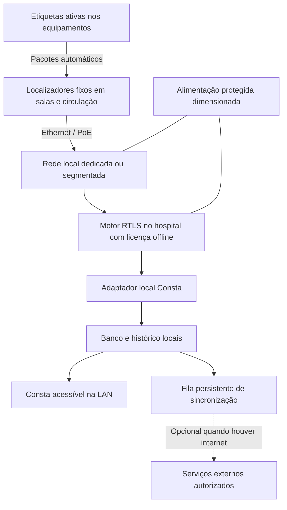

# Consta — RTLS automático com sensores fixos e operação local

Data: 06/11/2026. Requisitos esclarecidos por Matheus nesta conversa. Pesquisa documental de engenharia; nenhum produto foi comprado, instalado, integrado ou ensaiado. Esta passa a ser a referência do escopo de rastreamento. As notas anteriores de QR e de óptica são histórico de alternativas, não requisitos atuais.

**Nova direção de pesquisa:** Matheus solicitou tecnologia autoral. A [proposta autoral](CONSTA_TECNOLOGIA_AUTORAL_PROPOSTA.md) compara etiqueta óptica passiva e acústica ativa, com [matriz por modalidade](../research/CONSTA_MATRIZ_INTERFERENCIA_POR_MODALIDADE.md). Quuppa permanece referência comercial comparativa; não é produto escolhido nem garantia de segurança.

## O que estamos propondo

Uma etiqueta ativa em cada equipamento e localizadores fixos distribuídos pelo hospital, com atualização automática no Consta pela rede local. A experiência procurada é semelhante à de um rastreador de objetos: a movimentação é detectada sem ação de um funcionário.

**Sim, essa arquitetura existe comercialmente. Não encontramos demonstração pública de um conjunto que garanta, sem avaliação local, ausência de toda interferência e adequação a qualquer equipamento ou exame hospitalar.** Existência do rastreamento, independência da internet e compatibilidade clínica são propriedades distintas e precisam de evidências distintas.

## Requisitos atuais

| Requisito confirmado | Consequência de projeto |
| --- | --- |
| Nenhum QR, aproximação de celular ou leitura humana para atualizar posição | A etiqueta transmite automaticamente; não há botão de confirmação a cada movimento |
| Localizadores fixos em paredes/tetos e salas | Projetar cobertura por ambiente, validar montagem e cadastrar posições |
| Atualização quase em tempo real | Definir e medir latência de ponta a ponta e transição de sala com o hospital |
| Funcionar sem internet | Motor de localização, integração, banco, autenticação e interface essenciais locais; verificar licença offline do fornecedor |
| Não prejudicar pacientes, aparelhos, exames ou instalação elétrica | Exigir evidência do modelo e configuração, análise EMC/coexistência e avaliação por modalidade antes da liberação |
| Sem ruído incômodo | Não depender de buzzer/alto-falante de localização; avaliar ruído do produto e instalação reais |
| Internet permitida para conexão externa | Sincronização externa opcional; queda da WAN não participa do caminho crítico local |

A instalação inicial, o vínculo da etiqueta ao patrimônio e a manutenção física continuam necessários. Isso não é atualização manual de localização. A etiqueta se move com o ativo; o sistema registra automaticamente.

## Uma referência comercial concreta: Quuppa

O conjunto documentado é **etiquetas compatíveis + localizadores Q17/Q35 + Quuppa Positioning Engine (QPE) local + integração com Consta**. É candidato a avaliação, não indicação de compra nem aprovação clínica.

Os localizadores recebem pacotes de rádio das etiquetas, encaminham as observações por Ethernet e o motor estima posição. O método AoA utiliza direção de chegada, e não apenas “a antena mais perto”. Isso oferece um mecanismo de posicionamento, mas não garante sala correta em qualquer geometria. [Componentes e rede, fabricante](https://www.quuppa.com/documentation/network/topics/quuppa_components.html) · [Princípios das etiquetas](https://www.quuppa.com/documentation/compatible_tags/topics/tag_design_principles.html)

As posições dos sensores não devem ser decididas simplesmente como um sensor por parede ou por sala. O planejamento considera planta, orientação dos localizadores, obstáculos, metal, reflexões, densidade de etiquetas e fronteiras dos ambientes. A validação precisa incluir salas vizinhas, portas, equipamentos em uso e condições de montagem.

### A parte offline existe, mas exige configuração e licença específicas

O QPE pode rodar localmente. Contudo, a documentação declara que a configuração padrão interrompe rastreamento depois de **48 horas** sem validação no portal. O **Offline Module**, adquirido e ativado previamente, remove essa exigência de conectividade. A licença ainda tem validade e precisa ser renovada por arquivos; instalar localmente não elimina esse compromisso. [Documentação operacional do modo offline](https://www.quuppa.com/documentation/QPE/topics/offline_module.html)

Isso deve constar na especificação de contratação e no ensaio de aceitação. “Tem servidor on-premises” é evidência insuficiente para “funciona durante uma queda prolongada de internet”.

### Um exemplo real de etiqueta, e um impedimento prático

A QT1-1 demonstra a disponibilidade de uma etiqueta pequena, alimentada por bateria, com acelerômetro, LED e comunicação automática. O manual também restringe montagem em grandes superfícies metálicas e orienta limpeza com água/sabão, sem produtos químicos fortes. A bateria dessa versão não é substituível pelo usuário. **Logo, ela é referência de funcionamento, mas não pode ser escolhida como etiqueta hospitalar final apenas por caber no equipamento.** É necessário selecionar uma etiqueta compatível com desinfecção, fixação e operação do hospital. [Manual QT1-1](https://www.quuppa.com/documentation/QT1-1/topics/QT1-1_using_the_device.html)

O código visual eventualmente impresso por um fabricante não faz parte do fluxo Consta solicitado. Cadastro e comissionamento podem associar a identidade transmitida ao patrimônio; o fabricante documenta descoberta e configuração de lotes por API. Nenhuma leitura visual é necessária para registrar cada movimento. [Comissionamento por API](https://www.quuppa.com/documentation/QPE/topics/QPE_tag_batch_configuration.html)

## Arquitetura proposta para o Consta

Este diagrama é projeto proposto; não há adaptador implementado. A documentação pública confirma API de integração do QPE, mas a referência completa é disponibilizada no console/portal do cliente. O contrato exato e as versões precisam ser verificados antes da implementação. Não inventar endpoints ou tratar outra API de fornecedor como padrão universal. [Acesso à documentação](https://www.quuppa.com/documentation/megamap/topics/documentation_introduction.html)

O adaptador precisa receber identidade, posição/ambiente e instante de observação, preservar procedência e qualidade disponíveis, tratar duplicação e reordenação e registrar o instante de recebimento. Evento atrasado não deve substituir localização mais recente. Um painel aberto em nuvem não continuará vivo sem WAN apenas porque o RTLS é local: o Consta essencial também precisa ser servido na LAN, inclusive autenticação e dependências de execução.

Separação de rede, permissões, capacidade e qualidade de serviço devem ser definidas com TI para proteger os fluxos assistenciais. Rede segmentada não cria blindagem de rádio nem garante imunidade EMC; é um controle de tráfego e acesso.

### Comportamento esperado em falhas

| Falha | Comportamento a projetar e demonstrar |
| --- | --- |
| Internet externa indisponível, LAN e energia preservadas | Rastreamento e Consta local continuam; sincronização remota aguarda |
| Internet volta | Reprocessar fila com controle de duplicação; não reescrever a posição atual com histórico antigo |
| DNS ou identidade externos indisponíveis | A operação local essencial não depende desses serviços externos |
| Localizador ou trecho da LAN indisponível | Sinalizar perda de cobertura/qualidade; não inventar deslocamento ou presença |
| Motor de localização indisponível | Mostrar último evento com idade e falha explícita; estratégia de redundância depende da plataforma |
| Queda de energia | Continuidade somente dentro da autonomia e cobertura da alimentação protegida; PoE não é fonte de energia independente |
| Etiqueta sem bateria ou removida | Marcar ausência de atualização e diagnóstico disponível; nenhum posicionamento pode ser garantido |
| Licença expirada | Tratar como dependência operacional monitorada; prever renovação e testar comportamento real |

“Independente da internet” é um requisito realizável. “Imune a todas as quedas” não descreve um sistema real sem especificar tipo, duração e extensão da falha.

## Rede elétrica e ruído

PoE leva alimentação pelo cabo de dados, a partir de um switch/fonte apropriados. Não é PLC, que utiliza a instalação de energia como meio de comunicação. A proposta não injeta dados nas tomadas nem retira energia das portas dos aparelhos médicos. O fabricante documenta Ethernet e alimentação PoE nos localizadores. [Instalação Q17](https://www.quuppa.com/documentation/Q17/topics/Q17_using_the_device.html)

Isso reduz dependências e alterações nos aparelhos; **não prova ausência de ruído conduzido, emissão radiada, fuga elétrica, sobrecarga ou falha da instalação**. Fontes, switch, cabos, aterramento, isolamento aplicável, capacidade e localização física precisam de análise. O dimensionamento da infraestrutura fica com as equipes responsáveis.

O rastreamento de rádio não necessita de bipes para funcionar. Selecionar etiquetas silenciosas e desabilitar sinalizações sonoras opcionais quando existentes; avaliar também fontes e ventilação da infraestrutura. Em alternativa ultrassônica, “inaudível” não equivale automaticamente a ausência de efeitos acústicos ou interação com sensores.

## Se a restrição significar literalmente não adicionar RF

Há um precedente original particularmente próximo da ideia de Matheus: **Holm et al., ICASSP 2005, Indoors Data Communications Using Airborne Ultrasound**, DOI `10.1109/ICASSP.2005.1415870`. O trabalho descreve etiquetas que enviam ID por ultrassom, microfones instalados em parede/teto e detectores com Ethernet, encaminhando localização a um servidor. A comunicação etiqueta-detector dispensa canal de rádio e infravermelho. O artigo relata experiência hospitalar anterior como contexto; não é um laudo de segurança para a configuração Consta. [Artigo original e DOI](https://doi.org/10.1109/ICASSP.2005.1415870)

É **evidência de viabilidade da arquitetura**, não prova de disponibilidade comercial atual de todos os componentes ou de segurança universal. Sonitor atual combina tecnologias e não deve ser apresentado como aquele produto histórico. Telocate Wave anuncia etiquetas ultrassônicas e receptores fixos; sua página pública não comprova por si operação integral offline, ausência de rádio auxiliar ou adequação hospitalar. Ver [análise de ultrassom e óptica](../research/CONSTA_RTLS_ULTRASSOM_OPTICA_E_LIMITES.md).

Ultrassom transporta energia mecânica; eletrônica e fontes ainda exigem avaliação EMC. Reflexões, ruídos, bloqueio, capacidade simultânea e atualização precisam de ensaios. Se “não emitir RF” for requisito rígido, essa linha merece avaliação de fornecedor e bancada antes de declarar BLE como solução escolhida. Se o requisito for compatibilidade clínica demonstrada, BLE/AoA ou outra plataforma hospitalar pode ser avaliada sem exigir ausência absoluta de emissão.

## O que a documentação comprova sobre segurança

Declarações de conformidade e ensaios de rádio/EMC identificam modelo, normas e condições. Não são laudos de coexistência com cada aparelho instalado no hospital nem classificação de ressonância. O arquivo de pesquisa separa essas evidências: [compatibilidade e limites](../research/CONSTA_RTLS_EVIDENCIA_COMPATIBILIDADE.md).

O estudo Bluetooth de Wallin e Wajntraub encontrou compatibilidade na configuração testada, enquanto estudos RFID encontraram interferências em outras configurações. Isso demonstra que testar a combinação importa; não permite concluir que todo rádio seja perigoso ou que todo BLE seja seguro. [Bluetooth, 2004](https://pubmed.ncbi.nlm.nih.gov/14980934/) · [RFID, JAMA 2008](https://pubmed.ncbi.nlm.nih.gov/18577733/)

Ressonância, salas com navegação óptica e sensores particularmente suscetíveis exigem análise própria. Infravermelho também tem contraexemplo experimental de interferência em oxímetros. Não substituímos análise por uma mudança de portadora. [Mathes et al., 2008](https://pubmed.ncbi.nlm.nih.gov/18633032/)

## Decisão recomendada e critérios de aceitação

**Recomendo manter a proposta comercial como RTLS automático local e tratar a tecnologia física como seleção condicionada.** Quuppa com localizadores cabeados e módulo offline é uma referência concreta de arquitetura. Ultrassom puro com retorno Ethernet é a linha de investigação quando rádio intencional for proibido. Não escolher só pelo nome da tecnologia ou por alegação de marketing de “interference-free”.

Antes de selecionar um conjunto final, obter:

- Modelos exatos, firmware, documentação atual e disponibilidade de fornecimento/suporte no Brasil.
- Compatibilidade com limpeza e fixação de cada família de ativos; certificações e homologações aplicáveis aos modelos reais.
- Evidência de EMC e condições de instalação, complementada por avaliação dos aparelhos/exames definidos no piloto.
- Confirmação contratual de funcionamento offline, todas as dependências de licença e documentação de API local.
- Projeto de cobertura com planta, salas vizinhas, obstáculos e capacidade simultânea; não fixar número de sensores sem levantamento.
- Protocolo de aceitação para tempo de atualização, erro de sala, cobertura e falhas. Os limites devem ser acordados antes de medir; não há desempenho Consta medido nesta pesquisa.
- Ensaio de WAN desconectada, reinicialização offline, identidade/DNS externos indisponíveis, retorno da conexão, falha de receptor e expiração/renovação de licença em ambiente apropriado.
- Critérios clínicos e de qualidade de exame definidos por engenharia clínica/física médica/fabricantes, usando bancada, simuladores e fantomas antes de qualquer uso assistencial.

Nenhum contato comercial foi enviado, nenhum orçamento foi presumido e nenhuma condição de segurança foi comprovada em laboratório nesta tarefa. A entrega é uma base verificável para selecionar e testar o conjunto, sem reinventar a categoria de produto.

## Explicação para a equipe e a banca

> O Consta terá etiquetas que se comunicam automaticamente com localizadores instalados pelo hospital. O processamento e o mapa podem funcionar dentro da rede local, sem depender da internet. A movimentação não precisa ser registrada por funcionários. Já existem plataformas e pesquisas com essa arquitetura. A seleção final exigirá compatibilidade documentada e testes no ambiente de uso, incluindo aparelhos, exames e alimentação. Se rádio for vedado, investigaremos a alternativa ultrassônica com receptores cabeados.

## Fontes e aprofundamentos

- [Soluções comerciais, rede local e licenças](../research/CONSTA_RTLS_COMERCIAL_REDE_LOCAL.md)
- [EMC e evidência por produto](../research/CONSTA_RTLS_EVIDENCIA_COMPATIBILIDADE.md)
- [Ultrassom, óptica e limites](../research/CONSTA_RTLS_ULTRASSOM_OPTICA_E_LIMITES.md)
- [Pesquisa anterior de tecnologias](../research/CONSTA_TECNOLOGIAS_RASTREAMENTO.md)

Esta é uma pesquisa dirigida de fontes primárias, não revisão sistemática, certificação ou teste de integração. O estado documental do produto pode mudar; confirmar versão, licença e condições antes de contratar.
