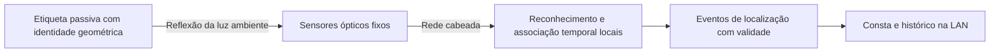

# Consta — tecnologia autoral: proposta de pesquisa e decisão de arquitetura

06/11/2026. Matheus quer desenvolver tecnologia própria inspirada em trabalhos existentes. Este documento registra alternativas e uma recomendação do pesquisador, **não uma arquitetura escolhida por Matheus, patenteabilidade, liberdade de exploração, protótipo construído ou segurança validada**.

**Aprofundamento posterior:** Matheus delimitou móveis em corredores/enfermarias e solicitou casos EUA/Europa e emulação de identidade. O [relatório comparativo](../../outputs/researchwrite/consta-optica-ble/exports/proposal_final.md) e a [emulação óptica](../../experiments/optical-tags/index.html) registram resultados sintéticos e recomendação operacional condicionada de BLE/AoA, mantendo óptica como P&D. A preferência inicial abaixo é histórico de hipótese; não é seleção definitiva.

**Direção atual após solicitação de Matheus:** continuar a óptica como candidata principal, sem transferi-la para uma linha secundária. O [protótipo V2](../../experiments/optical-tags/v2/README.md) e a [demonstração](../../experiments/optical-tags/v2/index.html) implementam retificação projetiva, redundância, tratamento limitado de oclusão e 1.024 identidades testadas sinteticamente. Preferências anteriores por BLE são histórico de recomendação, não substituem esta decisão de desenvolvimento.

## O problema de engenharia que vamos resolver

Localizar automaticamente equipamentos móveis com sensores fixos no hospital, sem QR, leitura humana ou registro manual a cada movimento; operar pela LAN mesmo sem internet; preservar aparelhos, exames, pacientes e instalação elétrica. Cadastro inicial e instalação existem, mas não participam da atualização operacional.

Não basta selecionar uma frequência “diferente da máquina”. Há caminhos elétricos, magnéticos, ópticos, acústicos e mecânicos distintos. Também precisamos avaliar o sentido inverso: o exame ou equipamento pode impedir o rastreamento ou danificar a etiqueta. “Todas as máquinas exatamente” exige inventário de fabricante, modelo, acessórios, software, montagem e ambiente. A matriz de famílias é um mapa de mecanismos, não autorização universal.

## Minha recomendação de pesquisa

**Prototipar primeiro uma etiqueta óptica passiva e reconhecimento automático por sensores fixos**, comparando a cobertura com uma etiqueta acústica ativa como segunda linha. A razão é uma propriedade verificável de construção: uma etiqueta sem circuito, bateria, magneto e transdutor não adiciona transmissão ativa de rádio ou som ao equipamento. Isso elimina esses mecanismos na etiqueta; não certifica os materiais, os sensores fixos ou o sistema inteiro.

A opção óptica muda o meio de detecção em relação à AirTag, preservando a experiência automática desejada. Ela depende de visibilidade. Se for indispensável rastrear um ativo totalmente encoberto, fechado em armário opaco ou sem caminho até os sensores, o desenho exclusivamente óptico não cumpre essa condição. Não esconder essa limitação no mapa ou substituir por estimativa apresentada como fato.

A linha ultrassônica mantém uma etiqueta que transmite automaticamente para receptores nas paredes/teto. É mais próxima de um beacon, mas bateria, circuitos e driver/transdutor precisam de avaliação; não pode ser declarada adequada à RM apenas por não usar rádio.

## Alternativa A — etiqueta passiva, sem QR e sem emissão ativa

### O que é a etiqueta

Uma peça/etiqueta com geometria visual distintiva, lida automaticamente pela infraestrutura. A identidade pode ser reconhecida a partir de uma configuração de elementos geométricos; isso não exige QR nem funcionário apontando um leitor. Ainda é um marcador visual deliberado: não estamos chamando um QR por outro nome nem prometendo distinguir unidades idênticas só pela aparência da máquina.

O candidato de material deve excluir circuitos, bateria, antena, imã, condutores, pigmentos metálicos, adesivos ou suportes não caracterizados. Isso é requisito de seleção, não declaração de que um plástico qualquer é MR Safe. O conjunto completo precisa ser documentado e avaliado, incluindo composição, limpeza, envelhecimento, fixação e posição no ativo.

O CCTag oferece um precedente de detecção/identidade por círculos concêntricos, com implementação pública sob MPL-2.0. Essa referência pode ser avaliada em bancada respeitando a licença; ela não é hardware hospitalar certificado e não demonstra originalidade da nossa solução. [Repositório e artigo dos autores](https://github.com/alicevision/CCTag)

### Sensores e fluxo

Sensores ópticos fixos observam áreas planejadas, reconhecem a etiqueta, estimam a posição/ambiente e enviam eventos ao motor local. Em uma primeira bancada comum, o processamento pode ocorrer em computador local ligado por cabo. A hipótese inicial usa luz ambiente visível, sem adicionar iluminação infravermelha pulsada ou ultrassom ao ambiente assistencial.

A proposta de algoritmo próprio combina identidade observada, múltiplos pontos de vista, posição conhecida dos sensores e transições entre ambientes. O sistema deverá rejeitar correspondências ambíguas e não usar a trajetória para afirmar uma identidade não observada com segurança. A contribuição possível está na implementação, na gestão de incerteza e na adequação hospitalar; ainda não é demonstração de novidade científica ou patenteável.

Em privacidade, a hipótese é processar localmente e reter apenas eventos do ativo, sem biometria nem gravação contínua de pessoas. Isso não apaga a captura inicial nem resolve a governança por si só: campo de visão, acesso, retenção técnica e aprovação institucional precisam ser definidos.

### Limites físicos e de escala

Visão exige caminho óptico. Cortinas, coberturas, portas fechadas, orientação e oclusão completa causam perda de leitura. Múltiplos marcadores no mesmo ativo e múltiplos sensores podem reduzir algumas perdas; não atravessam uma cobertura opaca. Iluminação baixa, reflexos, desfoque, distância e número de ativos também precisam ser medidos. Escala hospitalar não pode ser extrapolada de um ensaio com uma etiqueta.

O software mostrará observado, ambíguo, desatualizado ou desconhecido. Durante oclusão, não devemos apresentar a última sala como presença atual comprovada. A frequência de imagem de uma câmera também não é latência ponta a ponta garantida do Consta.

## O caso crítico da ressonância

Existem experimentos de rastreamento óptico com marcadores passivos em RM. Maclaren et al. desenvolveram câmera/iluminação especificamente compatíveis e avaliaram o sistema em condições delimitadas. O estudo também observou alterações de ruído RF e de homogeneidade do campo com sua unidade de câmera/iluminação. Isso demonstra viabilidade de engenharia óptica sob avaliação, **não autoriza uma câmera convencional ou a nossa etiqueta na sala**. [Artigo original, PLOS ONE 2012](https://pmc.ncbi.nlm.nih.gov/articles/PMC3492340/)

Tracoline documenta arquitetura com extensores ópticos para PET/RM e eletrônica fora do bore. “Fora do bore” significa fora do túnel, não necessariamente fora da sala ou da blindagem RF. Esse detalhe não pode ser usado para justificar cabos, lentes ou equipamentos atravessando paredes sem aprovação. [Artigo original](https://pmc.ncbi.nlm.nih.gov/articles/PMC6474595/)

Na linha Consta, a área de RM exige projeto específico de leitura: posição dos sensores, componentes permitidos, eventual caminho óptico e interface com a blindagem precisam ser definidos com o serviço e fabricante. Observar através de janela existente ou utilizar componentes ópticos dedicados são hipóteses de estudo; não garantem visibilidade de toda a sala. Não furar nem alterar blindagem como parte de uma demo.

Uma etiqueta passiva continua podendo afetar imagem pela composição, volume e posição. Não há classificação MR Safe/MR Conditional para o produto Consta; isso exige avaliação/rotulagem apropriadas. Sem esse módulo validado, o sistema pode registrar a última observação antes da entrada, mas **não atende rastreamento contínuo dentro da sala**. Essa limitação deve constar da decisão.

## Alternativa B — etiqueta ultrassônica autoral

Componentes funcionais propostos: microcontrolador sem rádio, alimentação própria, sensor de movimento opcional, driver e transdutor acústico. Ela transmite identificador e dados de integridade; microfones fixos detectam, processam e encaminham por Ethernet. Intervalo, potência, espectro, capacidade e protocolo seriam definidos por bancada, não copiados como garantia de outra instalação.

O precedente de Holm et al., ICASSP 2005, descreve comunicação por ultrassom sem rádio/IR entre etiqueta e detectores Ethernet. Pode inspirar um projeto próprio, respeitando direitos aplicáveis. Não basta repetir o princípio e afirmar que o inventamos. [Artigo e DOI](https://doi.org/10.1109/ICASSP.2005.1415870)

O ultrassom de rastreamento propagado no ar e o diagnóstico acoplado por gel possuem caminhos e condições distintos. Isso ajuda a formular ensaios, não prova que nunca haverá interação. Harmônicos, vibração estrutural, circuitos, níveis de emissão e sensores de outros equipamentos permanecem relevantes. O NIH explica os mecanismos de emissão/recepção e acoplamento do ultrassom diagnóstico. [NIH/NIBIB](https://www.nibib.nih.gov/science-education/science-topics/ultrasound)

Não usar a mesma etiqueta eletrônica dentro de RM sem avaliação própria. Desligamento automático por geofencing não remove bateria, materiais ou condutores; uma transição de zona não substitui adequação física.

## Parecer por família de máquina

A análise detalhada e suas fontes estão na [matriz por modalidade](../research/CONSTA_MATRIZ_INTERFERENCIA_POR_MODALIDADE.md). Não há resultado binário universal disponível para uma etiqueta que ainda não foi fabricada. Para cada linha, o estado atual é **não ensaiado**.

| Família | Mecanismo relevante e decisão preliminar de projeto |
| --- | --- |
| RM e PET/RM | Materiais, forças/torque, aquecimento, blindagem e artefatos; módulo óptico/material específico a avaliar, nenhuma etiqueta eletrônica genérica liberada |
| Raios X, TC, mamografia, fluoroscopia/angiógrafo e odontologia | Peças no feixe podem gerar sobreposição/artefatos; fixação fora do trajeto e métricas de imagem por protocolo; eletrônica dos leitores ainda avaliada |
| Ultrassom diagnóstico, Doppler e ecocardiografia | Preservar sonda, gel, cabos e trajetória; testar ruído eletrônico e, se usada, emissão acústica; diferenças de frequência não são prova de imunidade |
| HIFU, litotripsia e ultrassom terapêutico | Avaliar campos/energia e localização física próprios; não transferir resultado do ultrassom diagnóstico |
| PET, SPECT e gama-câmara | Atenuação, espalhamento, campo de aquisição e materiais; não assumir invisibilidade de uma peça passiva |
| Radioterapia | Não introduzir componente no feixe/arranjo sem avaliação de dose, imagem e mecânica pelo físico médico; a radiação também pode afetar leitores |
| ECG, EEG, EMG e monitores | Sinais sensíveis a ruído elétrico e movimento; conferir traçados, medidas e alarmes com infraestrutura ativa e baseline |
| Oxímetros, NIRS e navegação óptica | Sensibilidade óptica; evitar nova iluminação IR como premissa não testada, verificar caminhos visuais e fontes existentes |
| Bombas, ventiladores, anestesia, diálise, incubadoras | Preservar função, sensores, alarmes, fluxo, portas e ventilação; avaliação do desempenho essencial do modelo |
| Desfibriladores e eletrocirurgia | Emissões/transientes desses aparelhos podem perturbar ou danificar rastreadores; testar recuperação e validade dos eventos, sem conexões clínicas |
| Implantes ativos e programadores | Proximidade de fontes, imãs e comunicação; não extrapolar de aprovação de outro aparelho ou localizar pacientes como extensão automática |
| Laboratório, endoscopia, lasers e oftalmologia | Avaliar sensores ópticos, mecanismos móveis, refrigeração, intertravamentos e trajetos de luz/feixe conforme modelo |
| Aparelhos ligados a redes e alimentação | Ethernet não é blindagem EMC; proteger disponibilidade da LAN e avaliar fontes/cabos/aterramento, sem PLC ou uso de portas da máquina |

A matriz não pretende ser inventário de todo dispositivo existente. Um inventário do hospital permitirá transformar essas famílias em uma lista verificável de combinações concretas, incluindo acessórios e protocolos.

## O que será nosso e o que vem das referências

Podemos desenvolver etiqueta, geometria identificável, embalagem, montagem, firmware acústico se escolhido, leitores, protocolo, motor de identidade/localização, diagnósticos e integração Consta. A autoria virá de implementação própria e das partes licenciadas corretamente identificadas. Princípios ópticos/acústicos e RTLS já existem.

Há três avaliações distintas: possibilidade técnica, novidade/patenteabilidade e liberdade de exploração comercial. Melhorar uma solução não elimina automaticamente direitos anteriores. Artigo aberto não é licença para copiar código, circuito ou explorar patente. A [nota de referências e propriedade intelectual](../research/CONSTA_AUTORALIDADE_REFERENCIAS_E_PI.md) detalha o caminho usando fontes INPI/legislação e licenças verificadas. Não foi realizada análise jurídica de liberdade de exploração.

## Sequência de trabalho para decidir, sem fingir validação

1. Comparar em bancada a disponibilidade e identidade de marcadores passivos sob iluminação, distância, orientações e oclusão; usar objetos representativos e não pacientes.
2. Se a óptica não atender ao requisito de cobertura acordado, documentar a falha e avaliar a linha acústica em paralelo. Não trocar silenciosamente o requisito por uma posição presumida.
3. Definir lista de materiais e montagem da etiqueta, documentação dos sensores e equipamentos-alvo. Separar pacote geral do módulo RM.
4. Projetar operação local de ponta a ponta: sem licença, login, DNS, relógio ou mapa externos obrigatórios; alimentação/rede/servidor têm modos de falha explícitos.
5. Ensaiar desempenho clínico/qualidade de imagem com responsáveis e recursos adequados, além de limpeza, montagem, emissões e imunidade. O projeto de pesquisa não é liberação assistencial.
6. Somente então selecionar e declarar a configuração e as áreas autorizadas. A escolha e o desenvolvimento físico posteriores ainda não foram executados nesta tarefa.

## Como explicar a proposta autoral

> Estamos pesquisando uma identificação própria de equipamentos, automática e local. Nossa primeira linha usa uma etiqueta passiva, reconhecida por sensores ópticos fixos, sem bateria ou transmissão na peça presa à máquina. O Consta reúne as observações e informa posição, horário e validade. Uma segunda linha usa identificação ultrassônica quando fizer sentido. Ressonância e outras áreas críticas terão configuração específica e avaliação do conjunto. Usamos princípios publicados, com implementação e integração próprias; ainda precisamos demonstrar cobertura e compatibilidade nos modelos reais.

Nenhuma dessas alternativas foi apresentada aqui como invenção inédita ou produto seguro pronto. A entrega é uma proposta autoral de pesquisa que reduz mecanismos identificados e torna as lacunas verificáveis.
