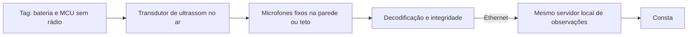

# Consta — candidatas para uma arquitetura autoral de localização automática

Pesquisa e proposta em 6 de novembro de 2026. **Este documento propõe um programa de engenharia; não descreve hardware implementado, patenteável, certificado ou aprovado para uso clínico.** Requisitos: identificar automaticamente o ativo por sensores fixos de teto/parede, sem QR e sem escaneamento pela equipe; funcionar na LAN sem internet; abranger o parque hospitalar, incluindo ambientes de ressonância, ultrassom e raios X, mediante módulos e validação apropriados.

## 1. Decisão proposta

Investigar uma plataforma própria com **identidade comum do ativo e dois módulos de observação**:

- **Óptico passivo:** uma marca geométrica sem eletrônica no equipamento, observada automaticamente sob luz visível ambiente. É a candidata que melhor reduz vias de interferência originadas na tag, mas depende de visibilidade e de infraestrutura óptica adequada.
- **Acústico ativo:** tag que transmite ID por ultrassom e receptores cabeados. Serve como candidata alternativa para áreas em que a óptica não oferece cobertura; acrescenta bateria, eletrônica e emissão acústica que exigem sua própria avaliação.

Não instalar automaticamente ambos no mesmo ativo: uma tag passiva adequada ao ambiente de RM não torna uma tag acústica afixada ao lado segura. A escolha do módulo por categoria/área deve ser registrada e validada. O núcleo Consta recebe observações de qualquer módulo e preserva fonte, horário e condições de validade.

**A contribuição autoral proposta é a integração e o desenho de operação:** identidade geométrica, cobertura planejada, fusão de observações por sala, transições e estados de incerteza, controle de compatibilidade por área e execução de manutenção. Visão computacional, marcadores passivos e localização acústica já existem. Não há pesquisa de anterioridade suficiente para alegar invenção exclusiva.

## 2. Candidata óptica passiva

### Objeto físico

Um suporte externo com desenho geométrico de alto contraste: por exemplo, uma constelação assimétrica de formas circulares cujas relações geométricas identificam o ativo no catálogo local. Trata-se de **hipótese de projeto**, não de um esquema de identificação já demonstrado. A marca não carrega URL, não exige leitor de QR e não pede ação do técnico a cada movimento.

A composição material alvo é não metálica, não magnética e eletricamente não condutora, sem bateria, antena, LED ou circuito. Essa descrição é um requisito a comprovar para **todo o conjunto**: substrato, pigmento, adesivo, laminação e fixador. Tinta preta, filme refletivo, pigmento ou suporte “plástico” não são automaticamente aprovados para RM. Não usar chapa metálica, fita com camada metálica ou elemento condutor por conveniência de montagem.

Uma opção para bancada é testar anéis concêntricos já publicados, antes de desenhar um catálogo próprio. O sistema **CCTag**, publicado por Calvet e colaboradores em CVPR 2016, detecta e identifica marcadores circulares por relações entre seus anéis. A implementação original é pública e documenta requisitos de suporte plano. Isso mostra que um identificador visual automático não precisa ter formato QR; **não valida leitura no teto de um hospital, material clínico ou segurança de RM**. [Artigo e implementação primária](https://github.com/alicevision/cctag); [documentação dos autores](https://cctag.readthedocs.io/en/stable/).

O **WhyCon** demonstra localização eficiente de marcadores circulares em visão computacional. Não basta imprimir círculos iguais e esperar distinguir equipamentos: identificação persistente demanda desenho identificável, catálogo e rejeição de correspondências ambíguas. [Artigo original](https://robotica.dc.uba.ar/public/papers/nitsche2015.pdf).

### Operação automática proposta

1. Cadastrar a correspondência entre geometria e patrimônio/série uma vez no processo de instalação. Esse vínculo de identidade não é escaneamento de cada movimentação.
2. Sensores fixos observam continuamente as regiões de passagem e armazenamento aprovadas. O algoritmo procura a geometria conhecida; não depende de reconhecimento facial.
3. Detecções passam por verificação geométrica, limites de distorção e confirmação temporal. Padrão parcial ou ambíguo pode produzir “não identificado”, em vez de inventar ID.
4. Cada sensor envia somente a observação necessária: identificador, ambiente ou zona calibrada, horário, método e diagnóstico da leitura.
5. O servidor local compara observações, aplica regras de transição e registra a última evidência válida. Não usa a simples ausência de imagem como confirmação de permanência.
6. O Consta mostra o ativo automaticamente na sala observada, a atualização e se a localização está vigente, antiga ou ambígua.

Para localizar por **sala**, o conhecimento do ambiente de cada sensor pode bastar. Coordenadas precisas exigem calibração e geometria adicionais; não são resultado já obtido. Um sensor com vista pela porta não pode assumir que tudo no campo de visão está na mesma sala: a imagem deve ser dividida em zonas ou o arranjo deve permitir distinguir a transição.

### Por que pode reduzir algumas vias de interferência

Uma marca inteiramente passiva, não condutora e sem circuito não gera sinais de rádio, pulsos de LED, clocks eletrônicos ou som. A proposta usa a iluminação visível já existente e evita acrescentar iluminador IR, laser, projetor de luz estruturada e flash. Isso remove mecanismos associados à própria tag e à iluminação adicionada; **não prova que o sistema completo não altera exames**.

A câmera continua sendo eletrônica. Em áreas comuns, um sensor cabeado ainda exige avaliação do conjunto, fonte e instalação. Em RM, não é suficiente desligar Wi-Fi nem retirar um ímã do suporte. Materiais, cabos, fontes, emissões e possíveis artefatos requerem projeto específico.

### Limitações físicas que permanecem

- Marca totalmente coberta por lençol, dentro de armário ou sem caminho óptico não é observada. Nenhum algoritmo recupera uma identidade visual que não chega ao sensor.
- Baixa luz, brilho, movimento, perspectiva, sujidade e distância reduzem a informação disponível. Sem iluminação adicionada, há ambientes em que a candidata pode não cumprir o requisito.
- Marcas em faces complementares e sensores com vistas diferentes podem reduzir oclusão, mas não eliminá-la. O conjunto de faces deve estar ligado à mesma identidade e submetido a validação.
- Um catálogo autoral precisa demonstrar separação entre IDs sob erros e distorções. Confundir duas marcas visualmente semelhantes seria uma falha de identificação, não mero erro de posição.
- Não existe alcance, tamanho de marcador, latência ou capacidade medidos para o Consta. Esses parâmetros devem ser obtidos na montagem real.

## 3. O que a literatura de RM autoriza inferir

Trabalhos de **rastreamento óptico de movimento durante RM** demonstram que óptica pode ser integrada ao ambiente após engenharia específica. Eles não demonstram que uma câmera comercial comum pode ser instalada com segurança no teto nem que um marcador de ativo hospitalar já foi validado.

**Maclaren e colaboradores, 2012:** construíram sistema de câmera e marcador passivo moiré para rastrear movimento durante RM. O trabalho inclui ensaios de compatibilidade e registra alterações de ruído RF e homogeneidade de campo nas condições investigadas. Portanto, mesmo um sistema óptico especialmente desenvolvido não é descrito adequadamente como “sem qualquer interação”. Sua iluminação e aplicação diferem da candidata Consta de luz ambiente. [Artigo original](https://pmc.ncbi.nlm.nih.gov/articles/PMC3492340/).

**Forman e colaboradores, 2011:** sistema óptico com câmera no bore e marcador; câmera/cabo exigiram modificações e blindagem. O estudo explicita a limitação por oclusão e campo de visão. Seu marcador usa códigos bidimensionais; não é a solução não-QR proposta aqui, mas demonstra requisitos de visibilidade e infraestrutura. [Artigo original](https://pmc.ncbi.nlm.nih.gov/articles/PMC3164440/).

**Tracoline, 2019:** o estudo utiliza extensores de visão com fibras ópticas para substituir componentes ativos dentro do bore por partes não elétricas/não magnéticas; câmera e fonte ficam fora do bore. Isso apoia investigar transporte óptico da imagem, **mas fora do bore não significa fora da sala blindada de RF**. O sistema usa iluminação própria e reconstrução de superfície, não reconhecimento ambiente de tag passiva. Não importar seus resultados para o Consta. [Artigo original](https://journals.plos.org/plosone/article?id=10.1371/journal.pone.0215524).

### Módulo de RM a pesquisar, não a declarar pronto

Uma linha de investigação é manter no ambiente sensível somente marcador passivo e cabeça óptica passiva, levando a imagem por **feixe de fibras de imagem** a sensores em posição aprovada pelo projeto. Fibra de dados ligada a uma câmera comum dentro da sala não remove a eletrônica da sala; são arquiteturas diferentes. Uma única fibra de telecomunicação também não transporta automaticamente uma imagem sem câmera e conversão eletrônica.

O trajeto por barreira RF exige projeto com a instalação e fabricante. Não perfurar blindagem, passar cabo improvisado ou presumir que qualquer fibra tem capa/armadura não condutora. Lentes, suporte, acabamento e fixação da cabeça passiva também precisam de análise. Resolução, campo de visão e transmissão sob luz ambiente são desafios próprios de um feixe de imagem.

Alternativamente, uma visada externa por janela existente pode ser investigada onde a geometria permitir. Janela com blindagem, reflexos e obstáculos podem impedir leitura; uma câmera do lado de fora não garante cobertura integral da sala. Equipamentos especiais de imagem RM já comercializados são referências de arquitetura condicionada, não peças automaticamente aprovadas para o Consta.

A FDA define a necessidade de avaliar e rotular segurança de dispositivos no ambiente MR. Propriedades não metálicas, não magnéticas e não condutoras são relevantes, mas não substituem avaliação do item completo e do uso proposto. **O Consta não possui classificação MR Safe ou MR Conditional.** [Orientação FDA de 2023](https://www.fda.gov/regulatory-information/search-fda-guidance-documents/testing-and-labeling-medical-devices-safety-magnetic-resonance-mr-environment).

## 4. Candidata acústica ativa

### Operação proposta

A tag transmite seu identificador e estado por mensagens acústicas; receptores reconhecem os pacotes e enviam eventos por cabo. Não precisa de canal RF para disparo, retorno ou configuração: **eliminar esses canais é requisito da arquitetura**, não suposição baseada no nome “ultrassom”. Um sensor de movimento e um protocolo de repetição/colisões são opções de projeto.

Holm e colaboradores, ICASSP 2005, documentaram comunicação tag–detector somente por ultrassom, sem canal RF/IR, com detectores Ethernet e servidor central. O precedente confirma plausibilidade do princípio. Ruído, reflexões e movimento fazem parte do problema de comunicação; o artigo não valida a candidata Consta. [Artigo original, DOI](https://doi.org/10.1109/ICASSP.2005.1415870); [texto depositado pelo autor](https://www.researchgate.net/publication/224612565_Indoors_data_communications_using_airborne_ultrasound).

A energia acústica é mecânica; trocar rádio por som evita o enlace intencional RF, mas não elimina emissões incidentais da eletrônica, riscos de bateria ou interação acústica com sensores. Estar fora de uma frequência usada em um exame não demonstra ausência de interação. Não apresentar a tag acústica de bancada como apta a entrar em RM.

A comparação deve medir disponibilidade de leitura sob condições em que a óptica falha, latência, colisões e identificação incorreta. Se o som não for detectado ou houver recepção em salas contíguas, mostrar perda/ambiguidade. Ultrassom tampouco garante rastrear um objeto em qualquer armário fechado ou atravessar qualquer barreira.

## 5. Cobrir todas as categorias sem inventar um acessório universal

| Categoria | Caminho de engenharia candidato | Evidência necessária antes de uso |
| --- | --- | --- |
| Bombas, monitores, carros e aparelhos móveis gerais | Comparar marcador passivo e tag acústica por cobertura e compatibilidade | Fixação, limpeza, desempenho essencial e sinal do aparelho no uso previsto |
| Ultrassom diagnóstico | Preferir investigar marca passiva externa ao trajeto do transdutor e às partes de contato | Imagem/sinal com fantoma, ergonomia e limpeza; não concluir segurança só pela diferença de frequência |
| Raios X, tomografia e fluoroscopia | Marca em superfície externa sem ocupar feixe, detector, colimador ou movimento | Ausência de obstrução/artefatos no posicionamento real; composição e fixação não são automaticamente radiotransparentes |
| RM fixa | Identidade do equipamento e mapa de instalação no Consta; observar acessórios móveis por módulo óptico específico | Análise da instalação, materiais, emissões/artefatos e segurança MR do conjunto |
| Acessórios móveis que entram na sala de RM | Investigar somente módulo compatível com esse uso, com preferência de pesquisa por alvo passivo integralmente dielétrico | Aprovação da configuração completa e condições de uso; tag de outra categoria não herda autorização |

Um scanner instalado permanentemente não exige o mesmo mecanismo para localizar uma bomba móvel: seu cadastro deve conter sala e instalação, enquanto o rastreamento automático se aplica aos itens que se deslocam. Não confundir localizar o aparelho na sala com rastrear peça no interior do bore ou junto à região anatômica examinada. Ambos são casos de uso diferentes.

## 6. Parte implementável como protótipo e parte clínica

### Protótipo óptico de bancada

- Câmera visível comum em suporte fixo, computador local e ligação USB/Ethernet, em ambiente de teste fora de área clínica e de RM.
- Marcadores impressos ou suportes experimentais de alto contraste, identificados como materiais de demonstração.
- Detecção de círculos/contornos, associação geométrica ao catálogo, rejeição de ambiguidade e observações locais. OpenCV oferece detecção de regiões circulares; isso é ferramenta de implementação, não solução pronta para identidade e segurança. [Documentação primária](https://docs.opencv.org/4.x/d0/d7a/classcv_1_1SimpleBlobDetector.html).
- Cenários com iluminação variável, giro, oclusão, portas e alvos parecidos. Mostrar quando o sistema não observa o ativo.

### Protótipo acústico de bancada

- MCU sem rádio, driver e transdutor acústico candidato; receptor adequado à banda e processamento em computador local.
- Alimentação, envelope da mensagem e detecção de integridade desenvolvidos para o ensaio; não reutilizar números de autonomia ou alcance de outro produto.
- Avaliação de taxa de detecção e confusão de ID sob múltiplas tags, reflexões e ruído.

### Módulo clínico posterior

Materiais especificados e rastreáveis; gabinete/fixação higienizáveis; requisitos formais; avaliação de risco; projeto elétrico/óptico/acústico; ensaios do conjunto; validação por categoria e área com responsáveis do hospital. Para RM, infraestrutura e condições específicas. Nenhum desses passos foi realizado para o Consta. Aprovação em uma sala ou modalidade não libera automaticamente outra.

## 7. Privacidade e LAN

No módulo visual, câmera registra luz de uma cena e pode captar pessoas mesmo que a finalidade seja equipamento. “Não fazemos reconhecimento facial” não significa “não tratamos imagem de paciente”. Propor campos de visão restritos, mascaramento, processamento local, descarte dos frames após extração e armazenamento apenas de eventos; logs de diagnóstico com imagens precisam de política explícita. A retenção mínima não corrige uma posição de câmera inadequada.

O motor, catálogo, autenticação, planta e histórico devem residir localmente, com rede e computadores capazes de operar sem WAN. Um componente chamado “edge” ou “on-premises” ainda pode depender de licença/login externo; ensaiar início a frio e funcionamento com internet bloqueada. Manter buffer e estado de falha observável. Estes são requisitos propostos, não capacidades implementadas.

## 8. Critério para escolher o caminho

A arquitetura deve ser escolhida por ensaio comparativo, não por uma promessa de imunidade:

1. A observação identifica corretamente o ativo e sala em todos os cenários de uso definidos?
2. Quais objetos ficam ocultos e por quanto tempo a localização se torna antiga?
3. A instalação funciona sem intervenção para cada deslocamento e sem internet?
4. Existe alteração de sinal, imagem, alarmes ou desempenho essencial nas condições avaliadas?
5. O acessório, sua fixação e os sensores cumprem os requisitos da área, inclusive RM e limpeza?

O módulo óptico passivo é um bom ponto de partida **para pesquisa de redução de vias originadas no acessório**. O acústico é uma alternativa física distinta que merece comparação de cobertura. Nenhum deles está escolhido como tecnologia clínica universal. O diferencial autoral defensável hoje é a proposta de arquitetura e de validação, não um resultado de segurança ou precisão já alcançado.
