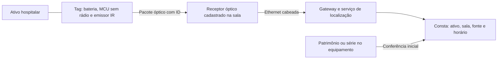

# Consta — proposta de dispositivo com comunicação óptica e infraestrutura cabeada

Pesquisa em 6 de novembro de 2026. **Proposta de engenharia para protótipo, não dispositivo desenvolvido, certificado ou liberado para hospital.** Esta nota responde à hipótese de rastreamento automático por sala sem acrescentar transmissores intencionais de radiofrequência. Não demonstra ausência de interferência, nem superioridade clínica do infravermelho.

## Recomendação e limite central

Uma opção tecnicamente explicável é uma **etiqueta ativa infravermelha**, fixada externamente no ativo, que transmite um identificador por pulsos de luz a receptores do ambiente. Os receptores encaminham as observações por rede cabeada ao Consta. O sistema determina **a sala do receptor que observou a etiqueta**, em vez de prometer coordenadas exatas. Essa é uma proposta inspirada em arquitetura publicada, adaptada aqui para equipamentos.

**Infravermelho é radiação eletromagnética óptica.** A expressão correta desta proposta é “sem enlace intencional de radiofrequência”, não “sem emissão eletromagnética”. Essa distinção também evita confundir a portadora óptica com a frequência de modulação elétrica do LED.

A seleção deve continuar aberta: infravermelho evita o enlace de rádio intencional, mas cria requisitos de visibilidade e de compatibilidade óptica. Há relato científico de interferência de sistema de navegação infravermelha em oxímetros; portanto, não apresentar luz infravermelha como automaticamente inofensiva aos exames. Ver discussão e referência clínica na [nota de segurança](CONSTA_EMC_EXAMES_E_SEGURANCA.md) e no [registro do artigo](https://pubmed.ncbi.nlm.nih.gov/18633032/).

## O que já existe na literatura

O trabalho original **The Active Badge Location System**, de Want, Hopper, Falcão e Gibbons, descreve etiquetas que emitem códigos infravermelhos, sensores fixos em salas e uma rede cabeada que leva as observações ao servidor. O caminho óptico pode ser direto ou refletido. A localização resulta do vínculo entre sensor e ambiente, com horário da observação. A opacidade de paredes ajuda a separar salas; bloqueios da etiqueta prejudicam a leitura. Isso demonstra o princípio de localização por ambiente, mas foi pesquisa de escritório e não validação clínica do Consta. [Artigo original, seções 3–4](https://roywant.com/cv/papers/pubs/1992-01%20%28ACM%20TOIS%29%20Active%20Badge.pdf).

O [arquivo oficial de Cambridge](https://www.cl.cam.ac.uk/research/dtg/attarchive/ab.html) também registra o desenvolvimento e a aplicação de uma versão simplificada para equipamentos. É precedente de engenharia, não prova de que qualquer tag atual possa entrar em qualquer sala hospitalar.

## Como funcionaria a proposta Consta

Esta sequência é uma **especificação proposta**, não resultado medido:

1. A engenharia associa o identificador da tag ao patrimônio ou série do ativo, conferindo a identidade física.
2. A tag desperta, emite um pacote óptico curto contendo identificador, contador de mensagens e estado de bateria, e retorna ao repouso. O intervalo depende da atualização requerida e dos ensaios de autonomia.
3. O receptor decodifica e valida a mensagem. Um receptor de teto ou parede está cadastrado em uma sala conhecida; ele não precisa fotografar pacientes.
4. O receptor transmite pelo cabo um evento com tag, receptor, horário e diagnóstico da leitura. O enlace pode terminar em serviço local; nuvem não é requisito físico do rastreamento.
5. O servidor agrega mensagens e aplica regras de estabilidade para evitar troca de sala a cada observação ambígua. Leituras simultâneas em portas abertas ficam explicitamente ambíguas até resolução.
6. O Consta mostra “última observação: sala X, fonte infravermelho, horário Y”. Perda de sinal gera localização desatualizada, nunca confirmação de que o ativo continua presente.
7. A equipe confirma patrimônio ou série antes de executar a manutenção. Localização não prova disponibilidade, limpeza ou liberação clínica.

A comunicação óptica não exige conexão elétrica ou de dados com a máquina médica. Isso reduz uma via de acoplamento direto, mas não elimina emissões incidentais da eletrônica nem interferência óptica. A alimentação da tag deve ser própria; não usar portas do equipamento sem autorização do fabricante.

## Componentes candidatos para bancada

A lista orienta um protótipo e não é uma lista de compra ou uma arquitetura clínica fechada.

| Bloco | Candidato com documentação primária | O que permite e o que falta |
| --- | --- | --- |
| MCU da tag | [TI MSP430FR2433](https://www.ti.com/product/MSP430FR2433) | MCU com modos de baixo consumo, temporizadores, ADC e interfaces seriais; a lista de funções não inclui rádio integrado. O consumo do MCU não equivale à autonomia da tag completa. |
| Emissor óptico | [Vishay TSAL6200](https://www.vishay.com/en/product/81010/) | LED emissor infravermelho, candidato para ensaio de enlace. Óptica, direção, corrente, proteção ocular e janela do gabinete precisam de projeto. Não adotar potência máxima apenas para ampliar cobertura. |
| Recepção óptica | [Vishay TSOP382/TSOP384, documento 82491](https://www.vishay.com/docs/82491/tsop382.pdf) | Receptor demodulador com filtragem/AGC. O protocolo deve respeitar formato de rajadas e pausas da versão escolhida. Não é receptor universal de qualquer sinal IR. |
| Rede do receptor | [WIZnet W5500](https://docs.wiznet.io/Product/Chip/Ethernet/W5500) | Controlador Ethernet com interface SPI para um MCU. Permite usar cabeamento; não transforma, sozinho, o produto em equipamento seguro para área assistencial. |
| Alimentação do receptor | [TI TPS23753A](https://www.ti.com/product/TPS23753A) ou módulo PoE projetado adequadamente | Referência de interface PoE e controle de conversor. Exige projeto de alimentação, isolamento quando aplicável, proteção, layout e ensaios do conjunto. |

A opção de prototipagem [W5500-EVB-Pico-PoE da WIZnet](https://docs.wiznet.io/Product/Chip/Ethernet/W5500/W5500-EVB-Pico-PoE) mostra que MCU, Ethernet e PoE podem ser integrados em uma plataforma de avaliação. Uma placa de avaliação exposta não deve ser instalada num hospital nem confundida com produto final.

No caminho óptico proposto, **um MCU sem rádio e Ethernet no receptor tornam desnecessários BLE/Wi-Fi/UWB**. Conferir a placa inteira e o firmware: escolher um chip sem rádio não garante que nenhum módulo adicional transmita. Fontes chaveadas, clocks e cabos continuam exigindo avaliação de emissões incidentais.

## Cobertura, oclusão e confiabilidade

Estas são medidas propostas a testar, não garantias de alcance:

- Posicionar a tag numa região externa visível, sem bloquear ventilação, controles, etiqueta do fabricante ou manutenção.
- Avaliar emissores em orientações complementares e receptores em posições diferentes, em vez de presumir que um sensor no centro do teto cobre toda a sala.
- Ensaiar equipamento girado, encostado na parede, entre outras máquinas, sob lençol, atrás de cortina e no transporte. Uma etiqueta totalmente opaca ao receptor não é localizada por luz.
- Cobrir os corredores e áreas de transição do escopo; uma sala instrumentada isolada não oferece rastreamento hospitalar completo.
- Usar identificação de pacote, integridade e repetição com variação temporal para lidar com transmissões coincidentes. Definir capacidade com ensaios de múltiplas tags.
- Medir erros de sala com portas abertas e superfícies refletoras. Receptores em zonas limítrofes devem poder declarar ambiguidade.
- Tratar falta de energia, bateria baixa, cabo desconectado, receptor deslocado e relógio incorreto como estados observáveis.

O fabricante dos receptores documenta sensibilidade a ambiente luminoso, forma do sinal e ruído de alimentação; sua nota de aplicação registra que luz solar direta e fontes luminosas fortes podem produzir pulsos espúrios. Filtragem reduz perturbação, mas não assegura cobertura num ambiente real. [Vishay, nota sobre receptores e fontes ambientais](https://www.vishay.com/docs/82904/irreceiversprecencesensorapps.pdf).

## Limpeza e fixação

A tag final precisaria de gabinete e janela óptica compatíveis com a rotina do hospital, superfícies acessíveis à limpeza, fixação que não solte nem obstrua a máquina e troca de bateria controlada. Material plástico comum e impressão 3D não demonstram resistência ao desinfetante, estanqueidade ou compatibilidade clínica. Essas características precisam de ensaio do conjunto e instruções de uso.

As recomendações CDC orientam seguir instruções dos fabricantes para limpeza e manutenção de equipamentos não críticos. A compatibilidade química, diluição e tempo de contato do desinfetante importam; a solução final deve ser definida com controle de infecção do hospital e fabricante do ativo. Isso é referência técnica internacional, não substitui regras locais. [CDC, recomendações de controle ambiental](https://www.cdc.gov/infection-control/hcp/environmental-control/recommendations.html).

## Por que ultrassom é alternativa, mas não “sem rádio” por definição

Ultrassom transmite informação por ondas mecânicas no ar. Uma arquitetura com tag emissora codificada, receptores cabeados e nenhum rádio é uma hipótese possível para reconhecimento de sala; não é automaticamente a arquitetura de um produto comercial. Ocultação, orientação, reflexões, ruído e interação com sensores acústicos permanecem itens de ensaio.

O sistema **Active Bat**, documentado pelos próprios pesquisadores em Cambridge, usa pulsos ultrassônicos captados no teto, **mas o disparo das tags usa rádio**. Logo, citar Active Bat como prova de sistema inteiramente sem RF estaria incorreto. [Descrição primária do Active Bat](https://www.cl.cam.ac.uk/research/dtg/attarchive/bat/). Trabalhos experimentais dos autores também analisam reflexões e caminhos múltiplos em posicionamento ultrassônico. [Harle et al., MobiSys 2003](https://www.usenix.org/legacy/event/mobisys03/tech/full_papers/harle/harle_html/).

A plataforma Sonitor atual declara combinação de ultrassom, BLE e outras tecnologias, inclusive integrações RFID. Isso comprova oferta comercial híbrida; não comprova que uma instalação particular seja livre de RF nem valida o desempenho do Consta. [Sonitor, infraestrutura RTLS](https://sonitor.com/platform/rtls-infrastructure/).

Não há base aqui para assegurar que “por não usar a frequência do ultrassom diagnóstico, não interfere”. A ausência de interação deve ser avaliada no ambiente e nos equipamentos definidos, inclusive ruídos, harmônicos e transdutores presentes.

## Escopo inicial e critérios para avançar

**Bancada:** demonstrar passagem de um equipamento fictício entre ambientes simulados, com recepção óptica real e eventos reais identificados. Se o hardware não estiver construído, apresentar a arquitetura e simular o evento com rótulo visível.

**Antes de piloto hospitalar:** revisar arquitetura com engenharia clínica, TI, controle de infecção e fabricantes; definir local de fixação, avaliação de segurança óptica, EMC do conjunto e compatibilidade com sensores ópticos. O precedente de oxímetros impede concluir que IR é seguro apenas por não ser rádio.

**Exames:** comparar o funcionamento dos aparelhos e qualidade de sinal/imagem nas condições de uso propostas, com simuladores ou fantomas e critérios definidos pelos responsáveis. Não fazer ensaio experimental com pacientes para demonstrar uma promessa.

**Ressonância:** excluir tag eletrônica, bateria, receptores e cabos da sala de exame no escopo inicial. Não chamar um produto de MR Safe ou MR Conditional sem avaliação e rotulagem específicas. Uma alternativa com leitura fora da zona restrita registra passagem/última localização e não localização contínua dentro da sala.

**Critério de decisão:** continuar com IR somente se os ensaios demonstrarem cobertura e compatibilidade suficientes. Se oclusão ou risco óptico inviabilizarem o caso, avaliar outra tecnologia ou integração RTLS existente, preservando no Consta o mesmo contrato de eventos e suas fontes.

## Explicação para o pitch

> “Para a hipótese de não adicionar rádio junto ao equipamento, estudamos uma tag óptica: ela envia seu identificador por luz infravermelha, receptores fixos reconhecem a sala e encaminham o evento por cabo ao Consta. O aplicativo mostra onde e quando o ativo foi observado. É uma arquitetura com precedente científico, ainda a validar no hospital. Não prometemos interferência zero: testaremos emissões da eletrônica, interação com sensores ópticos e o funcionamento dos equipamentos. Ressonância fica fora do escopo inicial.”

**Não há orçamento, autonomia de bateria, alcance, precisão, taxa de atualização ou capacidade hospitalar medidos para este dispositivo.** Esses resultados dependem do projeto e dos ensaios, não dos números de um componente isolado ou de outra implantação.
