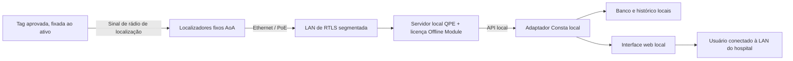

# Consta — RTLS comercial, sensores fixos e operação pela rede local

Pesquisa em 6 de novembro de 2026. Complemento à pesquisa anterior, incorporando a exigência atual de Matheus: **tag no ativo, sensores fixos na parede/teto, atualização automática próxima do tempo real, sem leitura por funcionário e funcionamento pela LAN mesmo sem Internet**. Este requisito substitui o uso de QR/leitura manual como solução de localização. Não houve compra, instalação, teste de bancada ou validação hospitalar.

## Conclusão de seleção

**Quuppa com localizadores Generation Q, tags aprovadas, motor QPE instalado localmente e Offline Module contratado é a arquitetura comercial mais claramente documentada nesta pesquisa para cumprir o requisito de operação contínua sem Internet.** É candidata para cotação/prova de conceito, não escolha homologada nem promessa de não interferência.

CenTrak é candidata relevante quando a prioridade é reconhecer salas por infraestrutura híbrida óptica/rádio; é preciso confirmar a versão atual e o caminho integral local. Sonitor oferece solução hospitalar multimodal, mas sua plataforma pública atual anuncia hospedagem em nuvem. Kontakt.io, na arquitetura Portal Light/Kio Cloud documentada, envia dados à nuvem. As duas últimas não podem ser prometidas como solução local sem Internet sem proposta técnica específica do fabricante.

| Candidata | Tag e sensores fixos | Evidência para operação LAN sem Internet | Condição decisiva |
| --- | --- | --- | --- |
| Quuppa | Tag compatível transmitindo; localizadores AoA fixos ligados por Ethernet; QPE local | Documentação técnica explícita de módulo offline | Generation Q, licença Offline Module pré-ativada e renovação manual em dia |
| CenTrak | Tags BLE ou multimodais, infraestrutura de localização e servidor/integração | Material técnico indexado descreve Core Server e endpoints REST/MQTT de parceiro on-premise | Confirmar edição vigente, licenças, autenticação, motor e conector totalmente locais; PDFs públicos citados retornaram 404 no acesso direto |
| SonitorONE | Tags e infraestrutura combinando ultrassom/BLE e outras modalidades | Página atual descreve cloud-hosted; não encontrei prova pública de funcionamento integral local | Pedir arquitetura suportada offline; não inferir a partir de gerações antigas |
| Kontakt.io Portal Light/Kio Cloud | Tags BLE, gateways e infraestrutura complementar | Documento de rede exige comunicação com Kio Cloud; não comprova motor local | Arquitetura documentada não satisfaz requisito estrito sem Internet |

A tabela é avaliação de adequação documental, não comparação de desempenho medido. Falta de prova pública não prova inexistência de opção contratual local.

## Quuppa: como funcionaria

A documentação de design informa que a localização usa ângulo de chegada do sinal transmitido pela tag. A antena e a implementação afetam a qualidade. Não basta comprar um beacon genérico: tags precisam transmitir os pacotes/perfis aceitos, e a Quuppa recomenda Approved Tags ou Tested Devices. Dispositivos emulados não testados ficam sob responsabilidade do cliente. Os canais proprietários e o suporte nativo também dependem de firmware, hardware e geração. [Design das tags](https://www.quuppa.com/documentation/compatible_tags/topics/tag_design_principles.html) · [Configuração e recomendação de tags](https://www.quuppa.com/documentation/QSP/topics/QSP_tags.html).

Localizadores fixos recebem os sinais, e o QPE processa os dados e disponibiliza resultados por APIs. Q17 e Q35 possuem conexão Ethernet e opção de alimentação PoE. O QPE comunica-se com localizadores por rede IP; sua operação normal consulta o portal Quuppa para licença, sincronização e monitoramento. A documentação oferece o módulo offline separadamente para Generation Q. [Componentes e requisitos de rede](https://www.quuppa.com/documentation/network/topics/quuppa_components.html).

### Tag real não equivale a tag hospitalar aprovada

O **QT1-1** é um exemplo concreto de tag compatível; o manual instrui ativação/configuração e montagem no objeto. Também alerta para evitar grandes superfícies metálicas, informa bateria não removível e não recarregável e limita limpeza a água/sabão ou pano seco, excluindo químicos agressivos, solventes e detergentes fortes. Portanto, a existência e a proteção contra água não comprovam compatibilidade com o protocolo de desinfecção hospitalar. Para o Consta, o integrador deve selecionar um modelo aprovado pelo ecossistema e adequado a limpeza, montagem e manutenção reais. O rastreamento operacional proposto é automático, sem leitura por funcionário. [Manual oficial do QT1-1](https://www.quuppa.com/documentation/QT1-1/topics/QT1-1_using_the_device.html).

### A dependência que precisa estar no orçamento

O **Offline Module precisa ser comprado e ativado previamente**. Sem ele, a documentação informa que o QPE interrompe rastreamento após **48 horas** sem verificar a licença no portal QCP. O módulo remove essa exigência, mas não torna a assinatura perpétua: arquivos de licença devem ser atualizados manualmente antes do vencimento. O procedimento usa uma mensagem de autenticação dos localizadores, transferência para acesso ao portal e retorno dos arquivos ao QPE local; adicionar localizadores exige repetir a autenticação. A documentação usa “online” também para indicar localizadores conectados ao QPE pela LAN, independentemente de Internet. [Procedimento técnico oficial](https://www.quuppa.com/documentation/QPE/topics/offline_module.html).

A recomendação de hardware do fabricante favorece QPE no mesmo local dos localizadores para reduzir latência e dependência de rede. As APIs podem ser acessadas por endereço local. A orientação também ressalta que dimensionamento e interoperabilidade precisam ser ensaiados no projeto real; as tabelas de capacidade são guias, não garantias. [QPE Hardware Recommendations](https://www.quuppa.com/documentation/megamap/topics/QPE_hardware.html).

### Arquitetura concreta candidata do Consta

O diagrama abaixo é uma proposta nossa, baseada nas interfaces descritas. Não representa instalação existente.

O cadastro inicial vincula a tag ao patrimônio do equipamento. Depois disso, a movimentação é detectada automaticamente pela infraestrutura; o fluxo não depende de alguém ler uma etiqueta em cada transferência. O integrador deve projetar cobertura, número e posição de sensores para a planta real. “Sensor na sala” não significa que sempre basta um sensor por sala, nem que a tag ficará visível sob metal, corpos, equipamentos e mobiliário.

O adaptador converteria saídas do motor em observações com identidade, horário, fonte, posição e qualidade disponível. Uma regra local associaria posição a polígonos/setores, com estados de ambiguidade e desatualização. Precisão e latência devem ser avaliadas ponta a ponta: intervalo da tag, observação dos localizadores, processamento, rede, API e atualização da interface. Especificação de rádio rápida não equivale a latência garantida da tela.

**O Consta também precisa ser local:** frontend, API, autenticação, banco, mapas e dependências de execução não podem exigir serviço externo para consultar localização. Uma interface local que consulta login cloud ou banco externo continua dependendo da Internet. Sincronização remota pode ser futura/opcional, fora do caminho crítico. LAN, alimentação, servidor e licenciamento continuam necessários mesmo em modo offline.

## CenTrak: hospitalar e com integração local documentada, porém a confirmar

A página atual de dispositivos descreve tags exclusivamente BLE e multimodais com opções UHF, Wi-Fi, baixa frequência e Gen2IR. É necessário identificar modelo e canal de retorno: precisão por IR não significa ausência de rádio. [Dispositivos oficiais](https://centrak.com/our-process/iot-devices).

O folheto técnico **Core Connector de 2025** indexado pelo buscador descreve um conector entre servidor CenTrak e serviços de parceiros, incluindo REST e broker MQTT on-premise. Isso é evidência de um caminho de integração local, mas **não comprova sozinho independência integral da Internet**, licenciamento offline ou disponibilidade de todas as funções no SKU ofertado. O acesso direto a esse PDF retornou 404 durante esta pesquisa; o conteúdo foi recuperado pelo índice, então deve ser solicitado ao fabricante antes de fundamentar contratação. [URL do documento técnico indexado](https://knowledge.centrak.com/wp-content/uploads/2025/04/Core-Connector_040225.pdf).

Também foi localizado o documento de requisitos de servidor/rede de 2021, hoje inacessível diretamente na URL pesquisada. Não usar esse material legado para fixar portas, capacidade ou sistemas operacionais de uma proposta nova. O produto TruView anuncia alarmes locais independentes da Internet, mas é outra família/uso; essa declaração não pode ser transferida automaticamente ao RTLS de ativos hospitalares. [TruView, escopo específico](https://centrak.com/solutions/truview-senior-living).

## Sonitor e Kontakt.io: não presumir que gateway local seja motor local

A plataforma SonitorONE anuncia integração REST, HL7/FHIR e capacidades multimodais, com arquitetura **cloud-hosted**. API não significa execução local: pode ser endpoint remoto. Não localizei documentação pública atual que detalhe licenciamento e operação de motor, integração e interface sem Internet. Deve-se pedir confirmação escrita por edição/modelo, sem assumir que gerações anteriores representam a oferta atual. [Plataforma oficial](https://sonitor.com/platform/).

O documento técnico Portal Light, publicado pelo fornecedor, descreve gateway BLE→Wi-Fi enviando dados ao Kio Cloud e exige liberação de domínios/URLs externos. Logo, ter receptores dentro do hospital não torna essa arquitetura independente de Internet. Armazenar e enviar dados depois também não cumpre, sozinho, visualizar novas posições localmente durante a queda. [Portal Light Network Requirements](https://kontakt-writers.s3.amazonaws.com/Kontakt_io_Portal_Light_Network_Requirements-pdf-en.pdf).

## Rede elétrica e dispositivos clínicos: o que esta arquitetura muda

A proposta usa bateria na tag e rede Ethernet/PoE dedicada à infraestrutura. Não envolve alimentar a tag a partir do equipamento médico, alterar seu firmware ou conectar-se ao seu circuito. Também não usa PLC, que transmite dados pelos condutores da instalação elétrica. Isso define separação funcional e reduz intervenções diretas; **não prova ausência de impacto**.

PoE e servidores consomem energia e usam eletrônica de alimentação. A instalação ainda precisa avaliar carga, fontes, cabeamento, proteção, aterramento e compatibilidade com o ambiente. Da mesma forma, BLE/AoA continua usando RF: posicionar receptores e separar VLANs não elimina exposição radiada, e canal proprietário menos ocupado não é atestado de compatibilidade com dispositivo médico. Avaliação de coexistência e EMC permanece necessária.

A tag deve ficar em local aprovado para fixação e limpeza, sem cobrir ventilação, sensores, telas ou identificações, e fora do campo de aquisição de imagem quando isso for exigido. Ressonância requer avaliação específica do conjunto tag/bateria/fixação; nenhum dos modelos pesquisados recebeu aqui liberação para entrar em sala de RM. O requisito clínico é preservar desempenho essencial e qualidade do exame nas condições efetivas de uso, a demonstrar por avaliação apropriada, e não por uma promessa geral baseada no nome da tecnologia.

## O que pedir ao integrador antes de selecionar

1. Lista exata de tags, sensores, firmware, motor e licenças, incluindo módulo offline e renovação.
2. Diagrama mostrando o caminho de localização sem tráfego externo, e quais funções ficam indisponíveis sem WAN.
3. Confirmação de login, consulta de posições e API local durante perda de Internet, reinicialização e vencimento/renovação planejada de licença.
4. Projeto de cobertura e critérios de aceite por ambiente, incluindo portas abertas, oclusão, ativos próximos e mudanças de andar.
5. Plano de atualização, backup, restauração e manutenção do servidor local.
6. Documentação de rádio/EMC e requisitos de montagem aplicáveis ao país e ao ambiente, além da avaliação por engenharia clínica/TI/infraestrutura.
7. Teste de aceite com WAN desconectada: movimentar a tag e comprovar novas observações na aplicação local, e não apenas um mapa em cache.

**Explicação curta para o pitch:** “Uma tag acompanha o equipamento e emite sua identificação para localizadores fixos. O motor instalado no hospital transforma essas observações em posição e horário, que o Consta associa às tarefas de manutenção. O processamento e a consulta funcionam pela rede local; a edição e o licenciamento offline serão contratados explicitamente. A implantação é condicionada à validação de cobertura e compatibilidade com os equipamentos e ambientes clínicos.”
