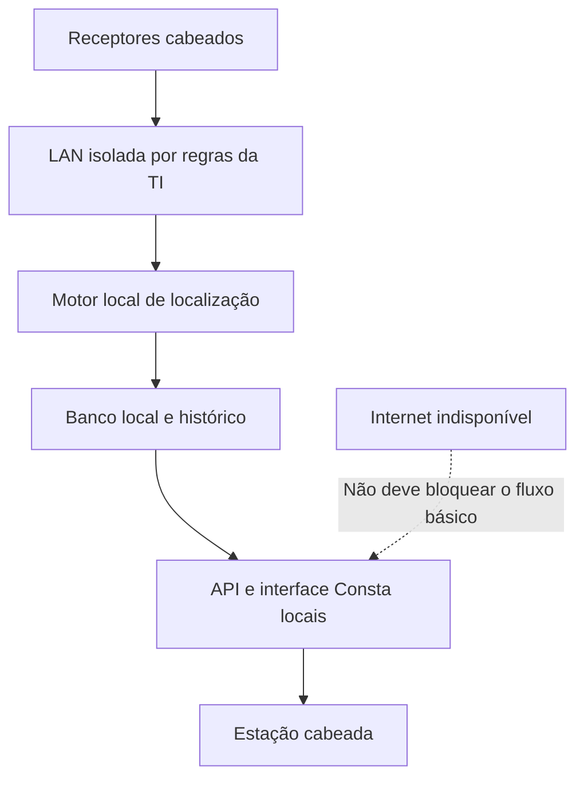

# Consta — RTLS automático, ultrassom, óptica e limites de uma operação local

Pesquisa em 6 de novembro de 2026. Requisito desta análise: tag no ativo, sensores fixos de parede/teto, localização automática por ambiente, atualização próxima do tempo real, **sem escaneamento e sem QR**, com software funcionando na rede local quando a internet cai. Hipótese adicional: não adicionar enlaces intencionais de radiofrequência.

## Conclusão de engenharia

**É possível conceber e há precedente científico para tag que transmite seu ID somente por ultrassom, receptores fixos e rede Ethernet até servidor local.** Isso atende conceitualmente à experiência de um rastreador automático. Não foi encontrado, nesta pesquisa, um pacote comercial atual com documentação pública suficiente para confirmar simultaneamente ausência de qualquer rádio, operação integral desconectada da internet e validação para os equipamentos/exames do hospital-alvo.

A distinção é essencial: **viabilidade física e precedente publicado não equivalem a produto atual disponível ou segurança clínica comprovada**. Não comprar “RTLS por ultrassom” presumindo que a tag não tem rádio: diferentes gerações usam fluxos opostos e tecnologias híbridas.

## Duas arquiteturas ultrassônicas diferentes

### A. A tag fala; o teto escuta — caminho adequado à hipótese sem RF

Holm, Hovind, Rostad e Holm publicaram em ICASSP 2005 um sistema experimentado com etiquetas ultrassônicas e detectores Ethernet, sem canal de rádio nem infravermelho para comunicação. A tag contém microcontrolador, transdutor e sensor de movimento; envia ID, bateria e bits de verificação. Os detectores usam microfones e processamento digital, encaminhando dados a um servidor central. O artigo cita experiência de instalação piloto hospitalar e discute ruído, reverberação, Doppler e dependência das condições ambientais. **O artigo não é laudo EMC nem demonstra segurança para todos os exames.** [Artigo original, DOI 10.1109/ICASSP.2005.1415870](https://doi.org/10.1109/ICASSP.2005.1415870); [texto integral depositado pelo autor](https://www.researchgate.net/publication/224612565_Indoors_data_communications_using_airborne_ultrasound); [cópia do artigo em proceedings](https://dihana.cps.unizar.es/proceedings/ICASSP/2005/pdfs/0300957.pdf).

Essa geração histórica ligada à Sonitor serve como **precedente**, não como especificação da Sonitor atual. O acesso direto ao último espelho apresentou problema de certificado TLS nesta consulta; o texto estava indexado e há depósito pelo próprio autor e identificador DOI.

Para o Consta, o receptor cadastrado informa o ambiente em que escutou a tag. Isso pode dispensar cálculo de coordenadas: reconhecer uma sala é um problema mais simples que localizar centímetros dentro dela. Portas abertas, propagação para ambientes contíguos e bloqueios precisam de lógica de ambiguidade e ensaio. Não prometer que “som nunca sai da sala”.

### B. O teto fala; a tag escuta e responde por rádio — arquitetura híbrida

Na documentação **Sonitor Sense Technology Brief**, os transmissores de localização fixos emitem o identificador ultrassônico do ambiente. As tags recebem esse código e enviam identidade, estado e localização por Wi-Fi ao motor de localização, usando pontos de acesso da instituição. Portanto, o uso do ultrassom para reconhecer a sala **não elimina o rádio do retorno de dados**. [Technology Brief do fabricante](https://static1.squarespace.com/static/635b76233daff54c9f23f767/t/659839899b7ff91869aabea6/1704475019006/100820%2BSonitor-Sonitor-Sense-Technology%2BBrief.pdf). O endereço foi encontrado indexado, mas a recuperação direta retornou 404 nesta sessão; a arquitetura é corroborada pelo [documento primário de integração HPE, seção Sonitor](https://www.hpe.com/psnow/downloadDoc/Designing%20hyper-aware%20healthcare%20facilities-a00100715enw.pdf?deepLink=&form=false&hf=regular&id=a00100715enw&isFutureVersion=true&originalObjectName=&prelaunchSection=&preview=false&print=&r=&section=&softrollSection=&ver=1).

A plataforma **SonitorONE** atual declara infraestrutura híbrida ULE/BLE, tags híbridas e arquitetura hospedada em nuvem. Ela confirma oferta comercial de localização hospitalar, mas não comprova o requisito “sem rádio e sem internet”. [Página primária da plataforma](https://sonitor.com/platform/).

Existe catálogo Cisco intitulado **Sonitor Sense On-Prem**. Isso é evidência de oferta com posicionamento local, não prova de funcionamento completo com WAN cortada: licenças, integração Cisco Spaces, login, atualizações, serviços de mapas e componentes de gestão devem ser confirmados na configuração contratada. Não adotar a alegação comercial de “nenhum risco de interferência” dessa página como conclusão independente. [Cisco, catálogo da integração](https://spaces.cisco.com/apps/sonitor-sense-on-prem/).

## Comparação dos candidatos encontrados

| Candidato | O que os documentos sustentam | Pendência para o Consta |
| --- | --- | --- |
| Arquitetura ultrassônica histórica Holm/Sonitor | Tag acústica, microfones, processamento e Ethernet; precedente de comunicação sem RF/IR | Disponibilidade de produto equivalente atual, documentação de segurança e validação local |
| Sonitor Sense | Sala emite ultrassom, tag recebe e devolve informações por Wi-Fi; há catálogo On-Prem | Não atende proibição completa de rádio; confirmar dependências externas e licença |
| SonitorONE atual | Plataforma hospitalar híbrida ULE/BLE e nuvem | Não assumir opção offline ou retirada completa de RF |
| Telocate Wave | Fabricante atual descreve tags ultrassônicas móveis e receptores fixos, como alternativa ao rádio | Ausência de RF em sincronização/retorno, Ethernet, servidor local, operação sem WAN e evidência hospitalar não documentadas suficientemente na página pública |
| CenTrak com HPE Aruba | Tags multimodo combinam Wi-Fi, infravermelho e RF de baixa frequência, com servidor de localização | É híbrido; não atende restrição total de RF; presença de servidor não garante operação offline |
| Midmark wired IR | Sensores de teto recebem IR e encaminham por rede cabeada; tags e funções RF/BLE continuam na oferta | “Wired” descreve infraestrutura, não ausência de rádio no sistema inteiro |
| Protótipo óptico próprio | Tag IR emissora e receptores cabeados são fisicamente viáveis e têm precedente científico | Oclusão, compatibilidade óptica e EMC do conjunto ainda precisam de ensaio |

A página do [Telocate Wave](https://en.telocate.de/wave-en/) comprova uma oferta industrial com emissores móveis e receptores fixos por ultrassom. Suas alegações de precisão e robustez são do fabricante; não demonstram resultados em hospital e não foram adotadas como especificação do Consta.

O [documento HPE Aruba/CenTrak de 2024](https://www.hpe.com/psnow/downloadDoc/HPE%20Aruba%20Networking%20and%20CenTrak-a00081787enw.pdf?deepLink=&form=false&hf=regular&id=a00081787enw&isFutureVersion=true&originalObjectName=&prelaunchSection=&preview=false&print=&r=&section=&softrollSection=&ver=1) mostra transporte de dados de tags pela infraestrutura Wi-Fi até o servidor CenTrak e saída dos eventos para aplicações integradas. É uma arquitetura automática de rastreamento; não é uma alternativa inteiramente óptica.

Na [oferta Midmark IR/RF de ativos](https://www.midmark.com/medical/rtls/products/detail/ir-asset-tags), as tags são descritas como IR/RF. A [rede de sensores IR](https://www.midmark.com/medical/rtls/products/detail/ir-sensory-network) tem opções cabeadas e opções wireless/BLE. Não há nesta consulta evidência pública suficiente de uma configuração atual completa sem transmissão RF em nenhuma função.

## Como operar sem internet

**Proposta arquitetural do Consta:** manter receptores, motor de localização, banco de eventos, autenticação e aplicação dentro da LAN. A etiqueta não consulta internet; sensores encaminham mensagens ao endereço local do serviço. Computadores acessam o Consta pela rede hospitalar. Caso o usuário exija ausência de rádio na infraestrutura inteira, a própria estação cliente também deve usar cabo, em vez de Wi-Fi.

“On-premises” e “offline” são requisitos diferentes. Critérios de aceitação propostos:

- Inicializar receptores, servidor e aplicação com acesso externo bloqueado, inclusive após reinício.
- Receber observações, trocar de ambiente, pesquisar ativo e registrar histórico sem login ou token de serviço externo.
- Manter nomes, planta, relógios e resolução de endereços disponíveis localmente; confirmar a política da TI para sincronização do tempo.
- Operar com licença válida sem verificação externa impeditiva, conforme termos do fornecedor.
- Acumular eventos durante indisponibilidade temporária do servidor e reenviá-los com integridade e ordenação definida.
- Mostrar falha de receptor, queda de energia e localização vencida; o silêncio de uma tag não deve parecer confirmação de presença.

Esses itens são **requisitos de projeto/ensaio**, não capacidades comprovadas de todos os fornecedores listados.

## Próximo do tempo real sem prometer instantaneidade

A atualização depende do intervalo de transmissão, disputa do canal entre tags, recepção válida, processamento e política de troca de sala. Uma tag pode transmitir automaticamente e ainda entregar uma observação atrasada. O piloto deve medir a distribuição da latência e as trocas de ambiente com ativos em movimento, além de quantas tags ficam sem leitura. Não existe taxa de atualização medida para o Consta nesta pesquisa.

Um sensor de movimento pode permitir transmitir mais durante deslocamento e menos parado; isso é uma estratégia de projeto, não autonomia de bateria garantida. O sistema não deve depender de alguém apontar câmera, escanear etiqueta ou apertar botão para registrar cada transferência.

## O que fazer se RF for proibida

1. **Exigir a arquitetura inteira em proposta técnica:** comunicação tag→sensor, sincronização, manutenção/configuração, sensor→servidor e acesso do usuário. Não aceitar apenas o rótulo “ultrassom”.
2. **Solicitar documentação de um produto acústico com tag emissora e sensores cabeados**, incluindo operação local, interfaces e ensaios. O histórico Holm/Sonitor e a oferta Telocate indicam caminhos para investigação; não constituem aprovação de compra.
3. **Se não houver produto que documente o requisito**, demonstrar apenas um protótipo acústico ou óptico em bancada, preservando o adaptador RTLS do Consta. Hardware próprio adiciona trabalho e validação; não fingir que um fabricante híbrido resolve a restrição.
4. **Caso o hospital permita RF sob condições**, reabrir comparação com BLE ou sistema híbrido existente, com avaliação por área e equipamento. Proibição total de rádio e compatibilidade clínica são perguntas distintas.

## Por que isso não autoriza prometer “sem interferências”

Ultrassom é onda mecânica; a ausência de enlace de rádio remove a emissão intencional RF usada no transporte de dados, mas eletrônica, cabos e fontes podem gerar emissões incidentais. Interação acústica com sensores também exige avaliação. Infravermelho é radiação eletromagnética óptica e pode afetar sensores ópticos: há relato de interferência de navegação IR em oxímetros. [Artigo clínico, PMID 18633032](https://pubmed.ncbi.nlm.nih.gov/18633032/).

Não concluir segurança do ultrassom de rastreamento apenas por operar em condições diferentes do ultrassom diagnóstico. Comparar qualidade de sinal/imagem e desempenho essencial em cenários representativos com simuladores/fantomas, responsáveis técnicos e critérios definidos. Ressonância exige análise própria de materiais, bateria, fixação e eletrônica; fica fora de um protótipo inicial não avaliado. Ver [pesquisa EMC e exames](CONSTA_EMC_EXAMES_E_SEGURANCA.md).

## Explicação curta para a equipe

> “O que queremos é uma tag automática, sem escaneamento. Para a hipótese sem rádio, a arquitetura candidata faz a tag transmitir seu identificador por ultrassom; sensores nas paredes ou teto escutam e enviam os eventos por cabo para um servidor dentro do hospital. O Consta mostra a última sala e o horário, mesmo sem internet. Há precedente científico desse fluxo. Muitos produtos modernos chamados ultrassônicos, porém, devolvem os dados por Wi-Fi ou BLE. Por isso precisamos confirmar o equipamento completo e validar cobertura e compatibilidade com os aparelhos do hospital. Não há promessa de interferência zero.”
